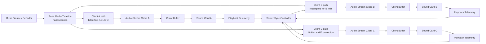
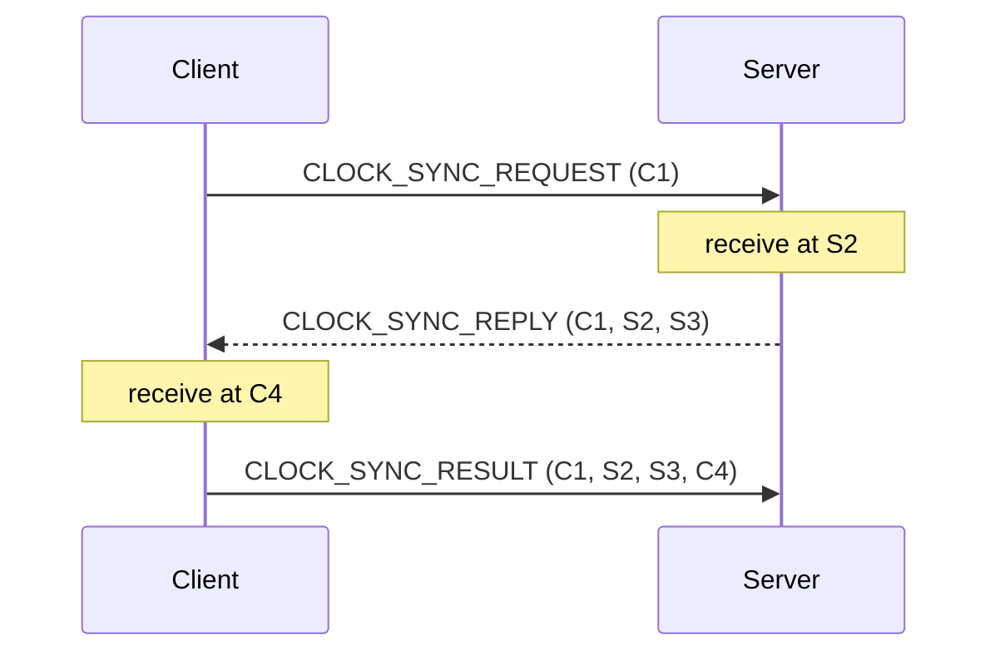
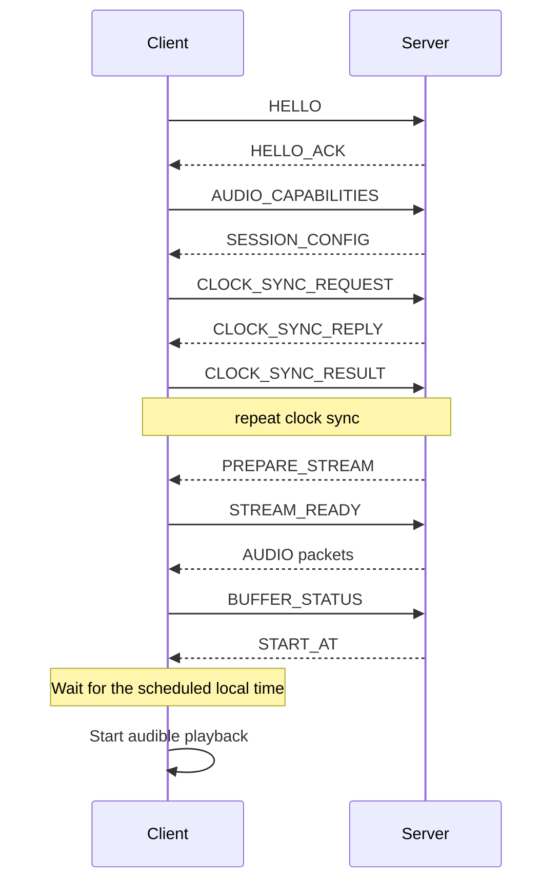
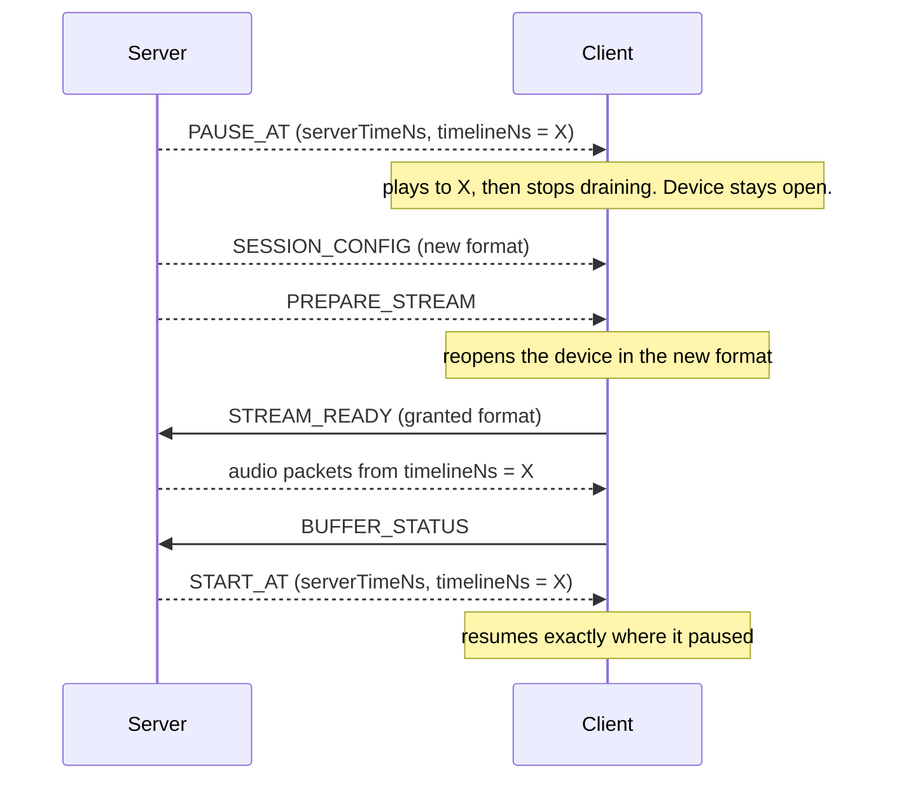
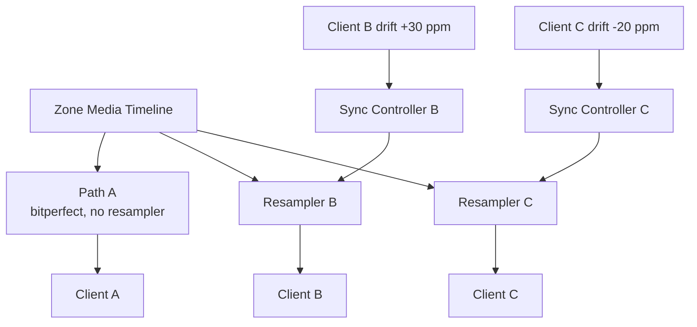
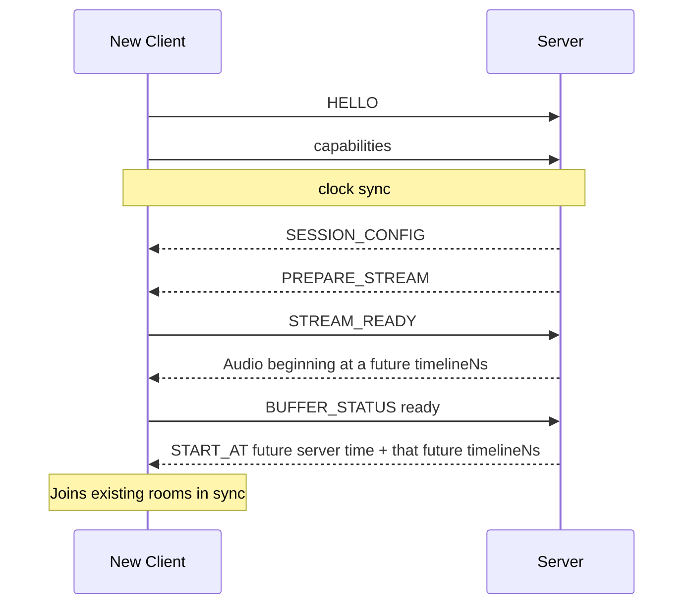
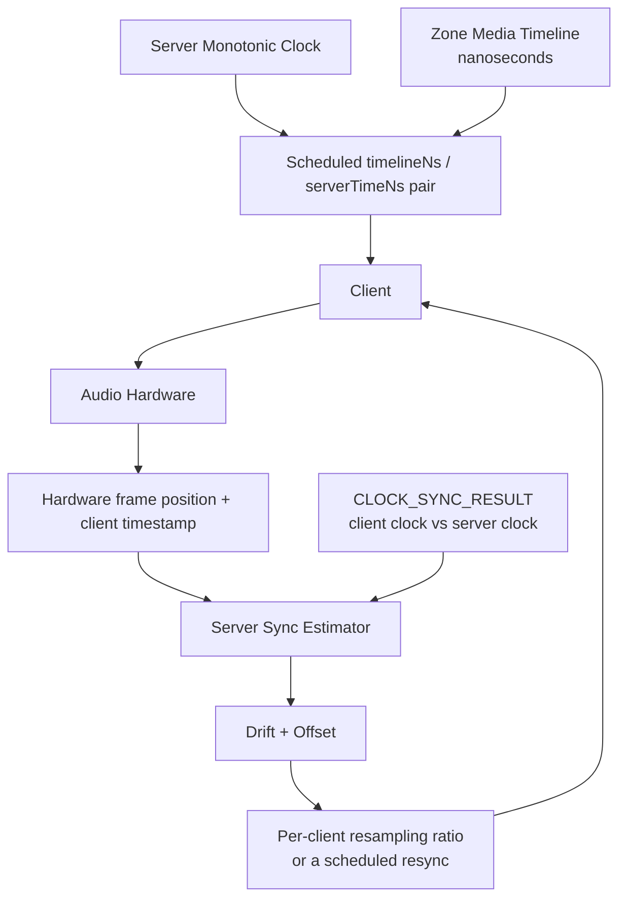
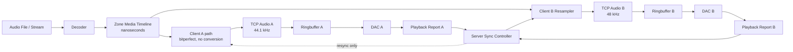

# Multiroom Audio Transfer Protocol (MATP)

**Status:** Design proposal
**Protocol version:** 2
**Target:** C++17 Audio Server + lightweight Windows/Linux clients, including ARMv6
**Primary goals:** synchronized multiroom playback, gapless playback, bitperfect lossless transport, server-side drift compensation

Version 2 replaced version 1's canonical PCM timeline -- a frame counter at one
fixed server rate -- with a **media timeline in nanoseconds**, so that a client
can be served **bitperfect** at the source's own sample rate instead of being
resampled into a common one. Every position version 1 expressed as a canonical
frame is a timeline nanosecond here, and the audio packet header changed with
it.

The change is wire-incompatible and there is no compatibility path. A peer that
announces `protocolVersion` 1 is refused rather than interpreted (section 51).

---

## 1. Design goals

The protocol must support:

- **Lossless audio**
- **Bitperfect transport wherever the client's device allows it** (section 2)
- A **sample-accurate common timeline** that is independent of any PCM rate
- Multiple clients starting the same stream at the same perceived time
- **Gapless playback** between tracks
- Server-side compensation for each client's sound-card clock drift
- Client buffer underrun detection
- Reconnect and resynchronization
- Windows and Linux clients
- Small embedded Linux devices including ARMv6
- Minimal client-side complexity

The client should remain relatively "dumb":

- receive audio
- buffer audio
- play audio
- report actual hardware playback position and clock information

The **server owns the global playback timeline and synchronization logic**.

A client never corrects its own playback rate, and never converts a sample
rate. Both are the server's, per client (sections 26 and 28). A client whose
board has a verified clock trim may *execute* the server's correction on it
(section 61); the decision stays the server's.

---

# 2. Transport format: raw PCM, bitperfect where possible

WAV is a file/container format. It is not a good network transport protocol, so
it is not used. The payload of an audio packet is:

> **Raw interleaved PCM**

in the format that packet's header names -- which is **the client's stream
format**, and for a bitperfect client that is the source's own format:

```text
44,100 Hz / 2 channels / signed 24-bit   a 44.1 kHz source, untouched
96,000 Hz / 2 channels / signed 24-bit   a 96 kHz source, untouched
48,000 Hz / 2 channels / signed 24-bit   what a 44.1 kHz source becomes for a
                                         client that can only do 48 kHz
```

Raw PCM is:

- lossless
- trivial to decode
- deterministic
- sample accurate
- gapless
- cheap enough for ARMv6
- easy to resample on the server, for the clients that need it

A future version may optionally support **FLAC frames** as the payload to
reduce bandwidth (section 41). Even then, every position in the protocol stays
a timeline nanosecond and every frame count stays a count of *decoded* PCM
frames.

## The bitperfect rule

> **Bitperfect** means that the sample rate, the channel count and channel
> order, and the numeric PCM sample values of the decoded original reach the
> client unchanged.

Byte identity of a container is **not** required. Repacking is allowed:

```text
24-bit packed  (3 bytes per sample)
        ->
24-bit in a 32-bit container
```

is bitperfect as long as the effective 24-bit sample values are identical. This
matters because the two layouts are what the two platforms' drivers accept
(section 12), and a client that can only take one of them is not thereby
disqualified from bitperfect playback.

The following are **not** bitperfect, and a server that does any of them to a
client's stream must not describe that stream as bitperfect:

- sample-rate conversion
- dither
- any change of a sample value
- DSP of any kind
- normalization
- channel mixing or reordering
- drift-correction resampling (section 28)

**A server serves a client bitperfect by default.** It may only convert when

1. the client cannot play the source format at all -- it is not in the
   capability list of section 12 -- or
2. drift correction is enabled for that client, which is resampling by
   definition (section 28).

Neither is a property of the zone: one room may be bitperfect while the room
next to it, on the same timeline and the same track, is resampled (section 5).

The client may still apply its own volume in its render path. That changes what
that room plays; it does not change whether the stream the server transported
was bitperfect, and it is the client's own decision rather than something the
protocol converts (section 39).

---

# 3. Recommended transport

Use two logical TCP connections per client:

```text
CONTROL TCP
AUDIO TCP
```

Example:

```text
4711 = control
4712 = audio
```

TCP is intentionally chosen for protocol version 1.

Advantages:

- lossless transmission
- ordered delivery
- retransmission is already handled
- simple implementation
- works on old Linux/ARM systems
- no FEC/retransmission protocol required
- audio arrival time does not determine playback time

The audio client uses a prebuffer, so small TCP retransmission delays do not immediately disturb playback.

A later protocol version could support UDP/QUIC, but it is not required for the initial implementation.

---

# 4. High-level architecture



Each client therefore receives its own output stream. That stream is the
decoded source untouched where the device can take it, and resampled -- for the
rate, for that room's hardware clock, or for both -- where it cannot.

The sync controller reaches only the paths it is correcting. A bitperfect path
it has nothing to say to: correcting that room would end its bitperfect
property, which is the one thing that client asked for. What the server does
about a bitperfect room that has drifted is the offset decision of section 29,
not a resampling ratio.

---

# 5. The zone media timeline

The central concept of the protocol is a continuously increasing **media
timeline**, expressed in **nanoseconds**:

```text
timelineNs = 0
timelineNs = 20,000,000
timelineNs = 180,000,000,000
```

One zone has exactly one timeline, and it answers exactly one question:

> Which media position should be audible when?

It deliberately does **not** answer:

> How many PCM frames does a particular client's output stream contain?

Those are two axes and they must stay strictly apart:

```text
Zone media timeline
    nanoseconds

        <- mapping (section 33) ->

Client stream
    PCM output frames
```

The timeline is **not** reset when a new track starts, and it does not depend
on any sample rate:

```text
Track A
44.1 kHz / 24 bit
timeline 0s ................. 180s

Track B
96 kHz / 24 bit
timeline                     180s ............. 420s

Track C
48 kHz / 16 bit
timeline                                      420s .....
```

It is independent of:

- the source sample rate
- any client's sample rate
- whether drift correction is active for a client
- the output frame count of any client's stream
- the packet size
- any sound card's frame position

That independence is the reason it is nanoseconds and not frames. Version 1's
canonical frame counter had to name a rate, that rate had to be the same for
everybody, and everything that was not already at that rate had to be resampled
into it -- which is exactly what section 2 now forbids by default.

**Nanoseconds are exact here, not approximate.** A position is a whole number
of nanoseconds and the mapping onto a client's frames is integer arithmetic
(section 33), so a 44.1 kHz frame boundary that is not a whole nanosecond is
still reached to the frame: the timeline is the axis positions are *named* on,
and the frame count for a span is computed from that span's two absolute
endpoints rather than accumulated packet by packet (section 15).

`uint64` nanoseconds run for 584 years, so a timeline that starts at zero when
a zone starts playing will not come near the end of the range.

---

# 6. Frame vs sample terminology

Positions are **nanoseconds** (section 5). Counts of audio data are **PCM
frames**, never samples.

For stereo audio:

```text
1 PCM frame =
    1 left sample
    +
    1 right sample
```

At 48 kHz stereo:

```text
48,000 PCM frames per second

not

96,000 units per second
```

This avoids ambiguity when channel counts change.

Both units appear in an audio packet header and they measure different things
(section 14):

```text
timelineStartNs      where the packet belongs on the zone timeline
timelineDurationNs   how much of that timeline it covers
outputFrameCount     PCM frames in the payload, for this one client
```

A frame count is therefore always **one client's**, and a nanosecond position
is always **everybody's**. Naming follows that split throughout: `...Ns` for the
shared timeline, `streamFrame` / `outputFrame` / `deviceFrame` for a client's
own axes (section 33). All of them are integers and the compiler cannot tell
them apart, which is why the names have to.

---

# 7. Server monotonic clock

The server maintains a monotonic high-resolution clock.

Conceptually:

```text
server_time_ns
```

Do NOT use wall-clock time such as UTC for precise playback synchronization.

Use a monotonic clock.

Examples:

```text
Linux:
CLOCK_MONOTONIC_RAW or CLOCK_MONOTONIC

Windows:
QueryPerformanceCounter
```

Wall-clock time may jump because of:

- NTP correction
- daylight saving changes
- manual clock changes

The playback timeline must never depend on those changes.

---

# 8. Client/server clock synchronization

Each client has its own monotonic clock.

The protocol must determine the relationship:

```text
client monotonic time
        <->
server monotonic time
```

Use an NTP-like four timestamp exchange.



Timestamps:

```text
C1 = client request send time
S2 = server request receive time
S3 = server reply send time
C4 = client reply receive time
```

Estimated clock offset:

```text
server_minus_client =
    ((S2 - C1) + (S3 - C4)) / 2
```

Estimated network round trip:

```text
RTT =
    (C4 - C1) - (S3 - S2)
```

Do this repeatedly.

For example:

```text
initial connection:
20 clock samples

during playback:
1 sample every 5-10 seconds
```

Prefer low-RTT samples because they generally have lower timing uncertainty.

The implementation should maintain a clock model instead of trusting a single
measurement (section 9).

## CLOCK_SYNC_RESULT, and why the server needs it

Only the client holds all four timestamps: it takes C1 and C4 itself, and the
reply hands it S2 and S3. The server knows nothing about C4 unless it is told,
so without a third message the server has **no** client/server clock model of
its own.

It needs one. `PLAYBACK_REPORT` (section 25) pairs a device frame position with
`localMonotonicTimeNs` -- the *client's* clock -- and the whole offset half of
the correction (sections 29 to 31) is the comparison

```text
what was actually audible in that room at a given server instant
        against
what the timeline says should have been audible then
```

The left side arrives in client time. Converting it into server time is
exactly what the model is for, so the server cannot compute an offset
correction without one, and a server that resampled on drift alone would hold
a room at a constant error forever.

The client therefore sends `CLOCK_SYNC_RESULT` after every exchange it
completes:

```json
{
  "type": "clockSyncResult",
  "clientSendNs": 821773000000,
  "serverReceiveNs": 102000120000,
  "serverSendNs": 102000135000,
  "clientReceiveNs": 821773310000
}
```

Three decisions the shape needs:

- **Raw timestamps, not the client's estimate.** The client reports; the server
  models (section 1). Sending `offsetNs` instead would make the server's
  correction depend on the client's estimator, and the server could no longer
  weight a sample by its own round trip or reject an outlier the client
  accepted.
- **It carries the four timestamps and nothing else.** `clientSendNs` is the
  correlator: the request already echoes it in the reply, and a monotonic clock
  does not produce the same nanosecond twice, so a sequence number would be a
  second identity for one thing.
- **Every completed exchange is reported, including one the client's own model
  rejected as an outlier.** The two sides filter independently, and a client
  that pre-filtered would hide the samples the server's own outlier test is
  there for.

The message is unanswered, best-effort telemetry, like `PLAYBACK_REPORT`: a
server that ignores it still works, and a client whose `CLOCK_SYNC_RESULT`
never arrives is a client the server cannot offset-correct rather than a
failed session.

---

# 9. Clock model

For higher accuracy, represent the relationship between client and server clock as:

```text
server_time = offset + client_time * scale
```

Where:

```text
offset = clock offset
scale  = clock frequency difference
```

Normally:

```text
scale ~= 1.0
```

This also detects oscillator drift between the client's CPU monotonic clock and the server clock.

---

# 10. Connection handshake

When a client connects:



`HELLO` and `AUDIO_CAPABILITIES` are both mandatory and must complete before
the server sends audio: the server cannot pick a stream format, or decide
whether this client can be served bitperfect at all, until it knows what the
client can play (sections 2 and 12).

`HELLO` is also where the protocol version is agreed. A mismatch ends the
connection there rather than later (section 51).

---

# 11. HELLO message

Example logical contents:

```json
{
  "type": "hello",
  "protocolVersion": 2,
  "clientId": "livingroom",
  "clientVersion": "0.1.0",
  "platform": "linux-armv6"
}
```

`protocolVersion` is **2**. A server that speaks a different version answers
with an `ERROR` and drops the connection instead of guessing what the client
meant; version 1 and version 2 disagree about what every position on the wire
means, so a half-understood session is worse than no session (section 51).

`clientId` MUST be stable across restarts and reconnects. The server keys each
client's own output stream, drift model and resampler state on it (see
`Info.md`), so a client that reports a new id on every start is treated as a
new room and loses its accumulated clock model.

It is therefore a persisted client setting (`clientId` in `client.json`), not
something generated at runtime.

The wire protocol does not have to use JSON for audio packets.

Control messages may initially use JSON.

---

# 12. Audio capability negotiation

`AUDIO_CAPABILITIES` is **mandatory** and MUST be sent immediately after
`HELLO_ACK`, before any audio is streamed.

The server maintains one individual output stream per client (see
`Info.md`) and needs to know what each client can actually play before it can
decide that stream's format. The capability list is what decides whether that
client can be served bitperfect at all (section 2): a source the device accepts
is sent untouched, and one it does not accept is converted for that client
alone.

A client MUST NOT be sent audio before it has reported its capabilities.

The list describes the **currently selected playback device**, as determined by
the client's capability scan. Only combinations the device actually accepted
are listed.

```json
{
  "type": "audioCapabilities",
  "deviceId": "hw:CARD=USB,DEV=0",
  "deviceName": "USB DAC",
  "preferredSampleRate": 48000,
  "accessMode": "exclusive",
  "formats": [
    {
      "sampleRate": 44100,
      "channels": 2,
      "sampleFormat": "s24le"
    },
    {
      "sampleRate": 48000,
      "channels": 2,
      "sampleFormat": "s24le"
    },
    {
      "sampleRate": 96000,
      "channels": 2,
      "sampleFormat": "s24le"
    },
    {
      "sampleRate": 48000,
      "channels": 2,
      "sampleFormat": "s16le"
    }
  ]
}
```

The list is therefore the set of formats bitperfect playback is *possible* in
for this room. A client that reports one rate only is a client every other
source has to be resampled for, and reporting the rates a device really accepts
is the single most useful thing a client can do for audio quality.

`preferredSampleRate` is a hint from the client's configuration. The server is
free to ignore it, and it MUST choose a format from `formats` -- but the
preference is a fallback rather than a target: where the source's own format is
in the list, section 2 has the server send that one instead.

## No playable device

A client with no usable playback device -- none found, none whose formats fit
its buffer -- still sends `AUDIO_CAPABILITIES`, with an empty `formats` list.
The session is established as usual, so the room is visible and can be sent
`RESCAN_AUDIO` or `SET_AUDIO_DEVICE`, but `SESSION_CONFIG` then carries no
`format` and the server sends no `PREPARE_STREAM`. The room is not ready until
a later `AUDIO_CAPABILITIES` lists a format, which re-negotiates as below. A
`SESSION_CONFIG` without `format` on an established session ends its stream.

## accessMode

`accessMode` is how the client will open the device, and `formats` are the
ones that mode accepted. `"exclusive"` is direct hardware access -- WASAPI
exclusive mode, ALSA `hw:`, the I2S driver -- with nothing between the samples
and the card, whose own clock the drift measurement then reads. `"shared"` goes
through a converting layer -- the Windows mixer, ALSA `plughw:` or `default` --
so the room is not bitperfect end to end even where the server sends the source
untouched, and the drift the client reports is that layer's clock rather than
the card's.

The client decides it from its own configuration and the device; the server
cannot set it. It changes only when the client selects its device again
(`SET_AUDIO_DEVICE`, `RESCAN_AUDIO`, section 56), and this message is sent
again when it does. The field is optional: a client that leaves it out has not
said, which the server reports as unknown. Any other value refuses the
message.

## hardwareVolume

`hardwareVolume` says whether the selected device has a volume control of its
own -- an ALSA mixer element, a WASAPI endpoint whose device applies the level
(`ENDPOINT_HARDWARE_SUPPORT_VOLUME`), a codec's DAC volume register. Where it
has one, the client can play `SET_VOLUME` (section 39) on that control and send
the samples to the device unscaled; section 59's Volume Control decides whether
it does, and what happens without one.

```json
"hardwareVolume": {
  "available": true,
  "control": "PCM",
  "steps": 256,
  "minDb": -102.0,
  "maxDb": 4.0,
  "hasMute": true
}
```

A device without one is `{"available": false}`. The field is optional: a
client that leaves it out has not said, which the server reports as unknown
rather than as "no hardware volume". When `available` is true, `steps` (at
least 2) is required; `minDb` and `maxDb` come together, with `maxDb` above
`minDb`, and are absent where the driver reports no decibels; `control` and
`hasMute` are optional. A malformed `hardwareVolume` refuses the message, like
a malformed format.

It is informational. `SET_VOLUME` is the same message on either path and its
gain means the same level: 1.0 is 0 dB on the device's control (or its top,
where that is lower), never above. A scheduled change on a hardware control
lands within the client's polling interval of its frame rather than on it.

## sampleFormat names

`sampleFormat` names a byte layout, not just a bit depth. 24-bit in particular
has two incompatible layouts on the wire and in the driver, and picking the
wrong one produces noise, not a quiet defect:

| `sampleFormat` | Bytes per sample | Layout | ALSA | WASAPI |
| --- | --- | --- | --- | --- |
| `s16le` | 2 | signed 16-bit LE | `S16_LE` | 16-bit PCM |
| `s24le3` | 3 | signed 24-bit LE, packed | `S24_3LE` | — |
| `s24le` | 4 | signed 24-bit LE in a 32-bit container | `S24_LE` | 24-bit valid in 32-bit |
| `s32le` | 4 | signed 32-bit LE | `S32_LE` | 32-bit PCM |
| `f32le` | 4 | 32-bit float LE | `FLOAT_LE` | IEEE float |

A client MUST NOT report `s24le` when its device only accepts packed 24-bit,
and vice versa. Where a device supports both, both are listed and the server
chooses. Converting between the two is repacking and stays bitperfect
(section 2); converting between bit depths is not.

## Re-negotiation

The client re-sends `AUDIO_CAPABILITIES` whenever its playback device or
device format changes at runtime (device switched through the control API, USB
DAC replaced, rescan performed). The server then re-negotiates that client's
stream; the other clients are unaffected.

The server re-negotiates a client's stream on its own initiative as well, and
the case that makes that mandatory is a **source format change** (section 24):
a bitperfect room playing a 44.1 kHz track cannot be handed 96 kHz audio
through the same device stream. Both directions use the same three messages in
the same order -- `SESSION_CONFIG`, `PREPARE_STREAM`, `STREAM_READY` -- so a
client needs no separate machinery for a mid-session format change, and a
`SESSION_CONFIG` arriving on an established session is a re-negotiation rather
than a protocol error.

## STREAM_READY

`SESSION_CONFIG` says what the server intends to send. It does not say that the
client's device is open in that format yet, and on both platforms a driver
*grants* a format rather than obeying one — WASAPI can refuse exclusive access
or hand back a different period, ALSA can substitute a rate. Opening a device
also takes time: tens of milliseconds for a healthy driver, seconds for one
that has just been plugged in or is being reopened after a failure. During that
window the client can play nothing at all.

The client therefore answers `PREPARE_STREAM` with `STREAM_READY`:

```json
{
  "type": "streamReady",
  "sessionId": "...",
  "ready": true,
  "format": {
    "sampleRate": 44100,
    "channels": 2,
    "sampleFormat": "s24le"
  },
  "periodFrames": 441
}
```

`format` is what the device actually granted, not what was requested. The
server MUST compare it against the `SESSION_CONFIG` it sent and MUST NOT send
audio in a format the client has not confirmed. A mismatch here is the 24-bit
layout problem from the table above: it produces noise, not a quiet defect.

A granted rate that differs from the requested one also ends the room's
bitperfect property for that track, because a driver that substituted a rate is
a driver the source does not fit through. The server has the information to
notice that -- it asked for one rate and was told another -- and it is the
server's to decide what to do about it, which is resampling that one room.

A client that cannot open the negotiated format does not improvise. It reports
`"ready": false` and re-sends `AUDIO_CAPABILITIES`, and the server chooses
again.

The client re-sends `STREAM_READY` with `"ready": false` as soon as it can no
longer play — device removed, taken over by another application in exclusive
mode, or being reopened after a format change — and again with `"ready": true`
once the device is open:

```json
{
  "type": "streamReady",
  "sessionId": "...",
  "ready": false,
  "reason": "the device was removed or reconfigured"
}
```

`reason` is a human-readable diagnostic, not an enumeration to switch on.

Clients with power controls also include `powerState`: `on`, `standby`,
`standbyManual`, `sleep` or `sleepButtonOnly`. (`off` meant manual standby before
2026-10-19 and is now invalid; it is reserved for a real power-off.)
It is optional for compatibility; absent means unknown, not powered off. A ready
stream requires `on`, but an `on` device can still report a hardware failure.
Automatic standby sends `ready: false`, `standby: true`, `powerState: "standby"`;
manual standby sends `ready: false`, `powerState: "standbyManual"`. Right before
deep sleep stops it, a client sends `ready: false` and either `powerState:
"sleep"` with `wakeOnLan` -- the wired MAC address, six lower-case hex pairs
separated by colons -- when it reaches the server over Ethernet and arms
Wake-on-LAN, or `powerState: "sleepButtonOnly"` when only its POWER button wakes
it. `wakeOnLan` is required with `sleep` and invalid otherwise. A new preparation reports
the current state again, including after a reconnect. The core exposes it in
`clients[].stream.powerState` and publishes `room.powerState` with `client` and
`powerState` when it changes. The server exposes `actual.powerState` on rooms
and forwards the event to its web clients. Disconnect clears the reported state,
except `sleep` and `sleepButtonOnly`, which the core keeps as top-level
`clients[].powerState` (with `wakeOnLan`; the server as `actual.powerState` and
`actual.wakeOnLan`) until the room's next session. For a room in `sleep` the
core sends a magic packet (UDP port 9, every interface's broadcast address) when
its zone is played, and on `client.wake` (server: `POST /api/v1/rooms/{client}/wake`).

A client reporting `"ready": false` is still connected, still answering clock
sync and still sending telemetry; it simply cannot be scheduled. The server
keeps that client's stream position, drift model and resampler state
(`Info.md`) — it is the same room, briefly deaf, not a new one.

A client MUST NOT report `"ready": true` before its device is open in the
negotiated format. Reporting it early is what turns a recoverable gap into a
room that silently misses the start.

The server chooses the stream format, per client, and its first choice is the
source's own (section 2). There is no "recommended common format" any more:
a common format was version 1's way of avoiding per-client streams, and the
server has one per client regardless.

---

# 13. Stream/session identity

Every playback session receives a random identifier:

```text
session_id
```

For example:

```text
128-bit UUID
```

Every audio packet includes the session ID or is sent on an audio TCP connection already bound to exactly one session.

The session ID prevents stale packets from an old playback session from being interpreted as current audio.

---

# 14. Binary audio packet format

Audio packets are binary.

```cpp
struct AudioPacketHeader
{
    uint32_t magic;              // 'MATP'
    uint16_t protocolVersion;    // 2
    uint16_t headerSize;

    uint64_t sessionIdHigh;
    uint64_t sessionIdLow;

    uint64_t sequenceNumber;

    uint64_t timelineStartNs;
    uint64_t timelineDurationNs;

    uint32_t sampleRate;
    uint16_t channels;
    uint16_t sampleFormat;

    uint32_t outputFrameCount;
    uint32_t payloadBytes;

    uint32_t flags;
    uint32_t headerCrc;
};
```

Version 2 of this header is **72 bytes**, big endian throughout. `headerSize`
names it; a receiver skips whatever it does not recognize rather than assuming
a length, so a later version may append fields without breaking a parser.

```text
offset  size  field
     0     4  magic ('MATP', 0x4D415450)
     4     2  protocolVersion
     6     2  headerSize
     8     8  sessionIdHigh
    16     8  sessionIdLow
    24     8  sequenceNumber
    32     8  timelineStartNs
    40     8  timelineDurationNs
    48     4  sampleRate
    52     2  channels
    54     2  sampleFormat
    56     4  outputFrameCount
    60     4  payloadBytes
    64     4  flags
    68     4  headerCrc
    72        payload
```

`headerCrc` covers the first 68 bytes -- the header up to but not including
itself -- so a longer header from a later version still checks out. It is
optional (section 42): zero means "not supplied".

## The two axes in one header

A packet occupies a span of the **zone timeline** and carries a number of **PCM
frames for one particular room**. Those are different units (sections 5 and 6),
so the header states both and a receiver must never derive one from the other:

```text
timelineStartNs      where the packet begins on the zone timeline
timelineDurationNs   how much of that timeline it covers
sampleRate           the rate of the payload, and of this client's stream
outputFrameCount     PCM frames in the payload, for this client only
payloadBytes         outputFrameCount * bytesPerFrame
```

The next packet of an uninterrupted stream begins at:

```text
nextTimelineStartNs = timelineStartNs + timelineDurationNs
```

**Timeline progress is never computed from `outputFrameCount` and `sampleRate`.**
A client that does so sees a room being drift-corrected disagree with the
server by a fraction of a millisecond per packet, reads that as a timeline
discontinuity, and rejoins -- repeatedly, for as long as the correction is
applied. The same is true without any correction at all: 480 frames at
44,100 Hz is 10,884,353.7 ns, and a receiver that rounded that per packet would
accumulate its own timeline error.

A receiver may refuse a packet whose frame count and duration are grossly
inconsistent -- more than a factor of two apart from `sampleRate` -- because
that is a sender error rather than a resampling ratio. Anything closer than
that is the server's business: a drift-corrected room's ratio is parts per
million from 1, and a bitperfect room's is exactly 1.

`flags` has one bit defined in version 2:

```text
bit 0   afterFlush   the first packet after a FLUSH (section 54)
```

A packet that sets any other bit is asking for something the receiver cannot
do and is refused rather than decoded as if the flag had not been there.

---

# 15. Audio packet meaning

One 20 ms span of the zone timeline, as three different clients receive it:

```text
timelineStartNs    = 12,000,000,000
timelineDurationNs =     20,000,000
```

| Client | `sampleRate` | `outputFrameCount` | Why |
| --- | --- | --- | --- |
| A, bitperfect 44.1 kHz | 44100 | 882 | the source's own rate |
| B, resampled to 48 kHz | 48000 | 960 | the device cannot do 44.1 kHz |
| C, 48 kHz + drift correction | 48000 | 960, occasionally 961 | that room's clock runs slow |

All three packets describe **the same span of the same music**. Nothing about
client A's stream can be derived from client B's, and neither says anything
about the timeline other than what its own two nanosecond fields say.

Recommended packet duration:

```text
10-20 ms
```

Do not use packet arrival time to calculate playback position (section 48).

## No accumulated rounding drift

A sender must not advance the timeline by converting each packet's frame count
into a duration on its own:

```cpp
// wrong: every packet rounds, and the error accumulates
timelineNs += frameCount * 1000000000 / sampleRate;
```

At 44.1 kHz with 480-frame packets that loses a fraction of a nanosecond per
packet, fifty times a second, forever. Instead, map **absolutely** from a base
and a source frame position, and take the duration as the difference of two
absolute positions:

```text
packetStartNs =
    sourceBaseTimelineNs
    + scaleAbsolute(sourceFrameStart)

packetEndNs =
    sourceBaseTimelineNs
    + scaleAbsolute(sourceFrameStart + frameCount)

durationNs =
    packetEndNs - packetStartNs
```

with `scaleAbsolute(frames) = frames * 1e9 / sampleRate` evaluated in integer
or rational arithmetic, never in a running float. Consecutive packets are then
exactly contiguous -- `packetEndNs` of one is `packetStartNs` of the next by
construction -- their individual durations differ by a nanosecond here and
there, and the timeline does not drift over a run of any length.

The same rule holds across a track boundary within one format (section 22): the
base and the source frame position carry on rather than being re-anchored.

---

# 16. TCP framing

TCP is a byte stream.

Therefore every protocol message needs explicit framing.

Recommended:

```text
uint32 messageLength
uint16 messageType
payload...
```

Conceptually:

```text
+--------------------+
| length             |
+--------------------+
| message type       |
+--------------------+
| message payload    |
+--------------------+
```

Never rely on one `recv()` call corresponding to one message.

---

# 17. Suggested message types

Control channel:

```text
HELLO
HELLO_ACK

CLOCK_SYNC_REQUEST
CLOCK_SYNC_REPLY
CLOCK_SYNC_RESULT

AUDIO_CAPABILITIES
SESSION_CONFIG

PREPARE_STREAM
STREAM_READY
START_AT
STOP_AT
PAUSE_AT
FLUSH

BUFFER_STATUS
PLAYBACK_REPORT
SYSTEM_REPORT

TRACK_INFO
TRACK_BOUNDARY

SET_VOLUME

PING
PONG

ERROR
```

Audio channel:

```text
STREAM_ATTACH       client -> server, binds the connection to the session
AUDIO_PCM
AUDIO_FLAC          optional future extension
```

---

# 18. Prebuffering

Audio should always arrive before it is required.

Recommended configurable target:

```text
LAN Ethernet:
500-1000 ms

Wi-Fi:
1000-3000 ms
```

Example:

```text
target buffer = 1500 ms
```

The target is a **duration**, not a frame count, and it stays one all the way
through: the client reports `bufferedDurationNs` (section 19) and the server
compares that against this number. What 1500 ms is in frames differs per room
-- 66,150 at 44.1 kHz, 72,000 at 48 kHz, 144,000 at 96 kHz -- and none of those
numbers is comparable with another room's.

The server sends audio until every participating client reports sufficient buffered content.

Only then is playback scheduled (section 20).

---

# 19. BUFFER_STATUS

The client reports:

```json
{
  "type": "bufferStatus",
  "sessionId": "...",
  "playheadTimelineNs": 195000000000,
  "bufferedUntilTimelineNs": 197000000000,
  "bufferedDurationNs": 2000000000
}
```

Every position here is a **timeline nanosecond**, because the server compares
this room's answer with every other room's and PCM frames are not comparable
between rooms with different rates or resampling ratios:

```text
playheadTimelineNs        the oldest timeline position still buffered
bufferedUntilTimelineNs   one past the newest buffered position
bufferedDurationNs        the span between the two
```

The two positions are **omitted**, rather than sent as zero, until the first
packet has arrived: `timelineNs` 0 is a real position on the timeline, and "no
audio yet" is not it. `bufferedDurationNs` is always present -- an empty buffer
holds zero nanoseconds, which is a fact rather than a missing value.

How many PCM frames that span became in this room's own stream is a local
implementation detail and is not reported.

This allows the server to know whether each room is ready.

## Pacing on the report

The same report is what the server paces each room's stream on: it sends
while what the room reported plus what has been sent since is below the target
buffer (section 18), and stops there. Pacing does **not** run on the server's
own clock. A room that is paused, or that has not started, does not drain, and
a sender pacing on its clock would fill a socket nobody is reading.

One exception: a room that is **known to be playing**. That means its
`START_AT` has been confirmed by a `PLAYBACK_REPORT` with an audible position
(section 25), and the zone's transport is playing, not paused or stopped. Such
a room drains at the line's rate whether or not its reports arrive. When its
`BUFFER_STATUS` has been missing for longer than a short gap (the reference
server uses 1 s, four reports at section 46's interval), the server may pace it
on the line instead. It then sends up to one target buffer past the position
the room is playing, and never further. The next report puts the rule above
back in force. Without this, a few seconds of late reports leave a playing
room starved until it plays its buffer empty, and the server then has to
rejoin it (section 43).

The client needs no change for this: the audio is ordinary packets on the
existing stream, and a full ring still closes the TCP receive window.

---

# 20. Synchronized START_AT

Once all clients are sufficiently buffered, the server chooses a future server monotonic time.

Example:

```text
current server time:
100,000,000,000 ns

start:
102,000,000,000 ns
```

Meaning:

```text
start in 2 seconds
```

Server sends:

```json
{
  "type": "startAt",
  "sessionId": "...",
  "serverTimeNs": 102000000000,
  "timelineNs": 180000000000
}
```

Semantics:

> Make media position `timelineNs` audible exactly at `serverTimeNs`.

Every client converts:

```text
serverTimeNs
```

into its local monotonic clock using the previously measured clock model
(sections 8 and 9), and then onto its own device frame axis (section 21). Which
frame of its own stream that timeline position is, is the mapping of section 33
-- a lookup, not a division, because only the client's own packets say how its
frames line up with the timeline.

All clients therefore make the same media position audible at the same
server-time instant, whatever rate each of them is playing it at.

Network packet arrival time is irrelevant as long as the packet arrived before the scheduled start.

## Waiting for clients to be ready

Before the **first** `START_AT` of a session, the server waits until every
participating client has reported both:

```text
STREAM_READY    ready: true                              device open in the negotiated format
BUFFER_STATUS   bufferedDurationNs >= minimum start buffer
```

Buffered audio is not enough on its own. A client can hold a full buffer while
its device is still being opened, and a client whose device will not open holds
a full buffer forever.

The wait is bounded by:

```text
client ready timeout
```

(see section 46). A client that has not reported ready by then is **left out of
this `START_AT`** and rejoined later at a future timeline position (section
43). One room with a device that will not open must never keep the other rooms
silent.

This barrier applies only while the session is not yet playing. Once audio is
playing, nothing waits for anybody:

| Event | Server behaviour |
| --- | --- |
| A new client connects (section 44) | Prepare it, wait for *that* client only, rejoin it at a future timeline position. The playing rooms are not held. |
| A client reconnects (section 43) | The same. |
| A client reports `"ready": false` | Drop it from scheduling, keep its state, rejoin it when it reports ready again. |
| Track boundary, same format (sections 22-23) | Nothing at all. A track boundary is not a readiness event. |
| Track boundary, **different format** (section 24) | The affected clients are re-prepared and re-started at the boundary position. The wait is bounded by the same timeout, and a client that misses it rejoins later. |
| The server reconfigures every client's format | The same procedure as a format change, for every room at once. |

The same-format row deserves spelling out, because it is the case that looks
like it needs a barrier and does not: the stream carries on unbroken, the
client MUST NOT reopen its device (section 23), and there is no
reinitialization to wait for. That is precisely what makes gapless playback
possible at all.

The different-format row is the one version 1 did not have, and section 24 is
the procedure for it.

---

# 21. More accurate client start

The client should not merely call:

```text
sleep_until(start)
audio.start()
```

because OS scheduling latency introduces jitter.

A better design is:

1. Open the audio device before the start.
2. Prime the device/buffer.
3. Establish the hardware clock.
4. Fill silence if necessary.
5. Convert `serverTimeNs` to local monotonic time, and `timelineNs` to a frame
   of this client's own buffered stream (section 33).
6. Align that frame with the device frame position the instant falls on, and
   let the render path compare frame counts from there.

The exact implementation differs between WASAPI and ALSA.

The protocol only provides the target timeline/time pair. What the client does
with it has to end on the sound card's own frame axis, because that is the only
axis on which a start is sample-accurate rather than as accurate as a wakeup
(section 48).

---

# 22. Gapless playback

Gapless playback is implemented by **never stopping or resetting the audio
timeline or the client's device stream between tracks**.

Incorrect:

```text
Track A
stop audio device
reset frame counter
start Track B
```

Correct:

```text
continuous PCM stream

Track A PCM
Track A PCM
Track A PCM
Track B PCM
Track B PCM
Track B PCM
```

Example timeline:

```text
Track A:
0 ... 180,000,000,000 ns

Track B:
180,000,000,000 ... 420,000,000,000 ns
```

The audio stream itself contains no gap, the timeline is not reset, and the
client's device keeps running.

This holds unconditionally when the two tracks have **the same audio format**,
which includes the common case of a whole album at one rate, and it holds for
a resampled room as well: what continues there is the room's own output stream,
at its own rate, with the same timeline underneath.

Two tracks with **different** formats cannot be gapless for a bitperfect room,
because the device has to be reopened. That is section 24, and it is a
deliberate trade rather than an oversight: a room that wants gapless across a
rate change can be given a resampled stream at one fixed rate instead, and the
server decides which of the two that client gets.

---

# 23. TRACK_BOUNDARY

Track changes are metadata, not playback discontinuities.

Example:

```json
{
  "type": "trackBoundary",
  "timelineNs": 180000000000,
  "trackId": "track-B",
  "title": "Second Song"
}
```

The client may update its UI exactly when the indicated timeline position
becomes audible.

It MUST NOT restart the audio device because of a track boundary. Where the
next track's format differs, what reconfigures the device is section 24's
procedure -- driven by the server, with a `PAUSE_AT` and a new `START_AT`
around it -- and not the boundary message. A client that reopened its device
because a boundary arrived would break gapless playback for every boundary that
did not need it.

`timelineNs` is required; `trackId` and `title` are optional, and a boundary
that names neither is still a boundary. The position is the part every room has
to agree on.

---

# 24. Source sample-rate changes and format transitions

A playlist may contain:

```text
44.1 kHz
48 kHz
96 kHz
```

Version 1 answered this by resampling everything into one canonical rate.
Version 2 does not: section 2 has the server transport the source untouched
wherever the client can play it, so a rate change in the source is a rate
change in that client's stream.

What is possible for one client's device stream is the constraint:

```text
bitperfect
+
a sample-rate change
+
uninterrupted gapless
```

cannot all three hold at once. A single open device stream has one rate, and
changing it means closing and reopening it -- tens of milliseconds at best, and
seconds for a driver that is slow to open (section 12).

The server therefore chooses, per client:

| Client's stream | Rate change in the source | Cost |
| --- | --- | --- |
| Bitperfect at the source's rate | device reopened, short silence at the boundary | not gapless across the change |
| Fixed rate, server resamples every source into it | nothing happens at all | not bitperfect |

Both are legitimate and the choice is per room, because the rooms do not have
to agree: a bitperfect listening room can take the gap while a bathroom speaker
on a resampled 48 kHz stream plays straight through the same boundary on the
same timeline.

## The format transition procedure

For a client whose stream format has to change at timeline position `X`:



1. The current track ends exactly at `timelineNs = X`.
2. `PAUSE_AT` stops the room cleanly at that position. Nothing is faded, cut
   short or overrun -- `X` is the first position of the *new* track, so the old
   one is played to its end.
3. The new stream configuration is negotiated with `SESSION_CONFIG`
   (section 12's re-negotiation).
4. `PREPARE_STREAM` has the client open its device in the new format.
5. The client answers `STREAM_READY` with what the driver granted.
6. The server waits for the clients involved, **bounded** by the client ready
   timeout of section 46.
7. New packets, in the new format, from `timelineNs = X` onward, are buffered.
8. `START_AT(serverTimeNs, timelineNs = X)` schedules the resume.
9. Every ready client resumes in sync, at the position the old track ended on.
10. A client that was not ready in time is rejoined later (section 43), at a
    future timeline position.

**One client must never block the zone.** Step 6's timeout is what guarantees
that; a room whose device is slow to reopen misses the beginning of the new
track and joins during it, which is what section 20's barrier already does for
a room that is slow to start.

The transition is not gapless and is not pretending to be. What it *is* is
**sample-accurate on both sides of the gap**: the old track stops at `X` and
the new one starts at `X`, so no media time is lost or repeated, and the rooms
that did not have to reconfigure never left the timeline at all.

---

# 25. Playback telemetry

The server requires information about what the sound card actually played.

The client periodically sends a `PLAYBACK_REPORT`.

Recommended interval:

```text
250-1000 ms
```

Example:

```json
{
  "type": "playbackReport",
  "sessionId": "...",

  "localMonotonicTimeNs": 821773812345,

  "deviceFramePosition": 23849231,

  "timelineNsAudible": 195349312000,

  "bufferedDurationNs": 1470000000,

  "underruns": 0,

  "clockQuality": "driver",

  "measuredSampleRate": 48001.44,
  "measuredDriftPpm": 30.0,
  "driftConfidence": 0.97
}
```

The important values are:

```text
deviceFramePosition     this client's own hardware frame counter
localMonotonicTimeNs    the instant that counter was read, on the client's clock
timelineNsAudible       where that puts the room on the zone timeline
```

**The first two are frames and client time; the third is the shared timeline.**
They must not be merged or confused: `deviceFramePosition` is a position on the
sound card's own axis at this client's own rate, and it means nothing in any
other room. `timelineNsAudible` is the same instant expressed on the one axis
every room shares, which is what makes rooms comparable, and the client
produces it through the mapping of section 33.

`timelineNsAudible` is **omitted** while the room has no audible timeline
position at all -- before the scheduled start, or when the mapping cannot place
the frame the card is on. The two position fields above it stay mandatory: a
server that sees `clockQuality: "unavailable"` knows the client is there and
that its position is worthless, which is not what a missing report says.

## Client-measured drift

The client runs its own `DriftEstimator` over `deviceFramePosition` against
`localMonotonicTimeNs` and reports the result:

```text
measuredSampleRate   regressed hardware rate in Hz
measuredDriftPpm     ((measuredSampleRate / nominalSampleRate) - 1) * 1e6
driftConfidence      0.0 .. 1.0, from window fill and residual spread
```

`measuredSampleRate` is in the rate of the client's *current* stream format, so
a format transition (section 24) ends the series: the nominal rate changed, the
device was reopened, and its frame counter started again. The client resets its
estimator there and `driftConfidence` climbs back from nothing, which is the
same thing that happens after a reconnect.

The client measures. It never corrects. The reported value is an input to the
server's sync controller, which owns the correction for that client's stream.

`driftConfidence` lets the server discount a young or noisy estimate instead of
reacting to it. It is low right after a start or reconnect, while the rolling
window is still filling, and drops when `clockQuality` degrades to `estimated`.

The fields are optional in the sense that a client with no usable clock omits
them and reports `clockQuality: "unavailable"`; the raw position fields stay
mandatory.

The report should be based on the native audio hardware/driver clock:

```text
Windows:
IAudioClock

Linux:
ALSA high-resolution audio timestamps / PCM status
```

It must NOT merely count how many samples the application has submitted to the API.

---

# 26. Sound-card drift: measured by the client, corrected by the server

The client estimates the drift of its own sound card and reports it in every
`PLAYBACK_REPORT` (see section 25). The server consumes that value and decides
the correction; the client applies nothing.

The server keeps the raw regression as well, because it needs the client's
positions in **server** time anyway -- which is what `CLOCK_SYNC_RESULT` is for
(section 8) -- and the cross-check catches a client whose own estimate is
wrong.

Every physical sound card has a slightly imperfect oscillator.

A nominal:

```text
48,000 Hz
```

device may actually run at:

```text
48,001.44 Hz
```

This is:

```text
+30 ppm
```

The server converts each report's client timestamp into server time using the
clock model it built from `CLOCK_SYNC_RESULT`.

It can then regress:

```text
device frame position
```

against:

```text
server monotonic time
```

over multiple seconds.

Example:

```text
measuredDeviceRate = 48001.44 Hz
nominalDeviceRate  = 48000.00 Hz

driftPpm =
    ((48001.44 / 48000.0) - 1)
    * 1,000,000

= +30 ppm
```

The nominal rate is **this client's stream rate**, not a rate the zone shares.
A room playing a bitperfect 44.1 kHz stream is measured against 44,100 Hz, and
its drift figure is comparable with a 96 kHz room's only because ppm is a
ratio.

Use a rolling regression window rather than only two samples.

Example:

```text
10-30 seconds
```

Where the client's `measuredDriftPpm` and the server's own regression disagree
by more than a few ppm with high `driftConfidence` on both sides, the clock-sync
model between the two is suspect, not the sound card. Log it rather than
feeding the difference into the resampler.

---

# 27. Why drift matters

Assume two devices:

```text
Room A = +30 ppm
Room B = -20 ppm
```

Difference:

```text
50 ppm
```

After 10 minutes:

```text
600 seconds * 50 ppm
= 0.030 seconds
= 30 ms
```

That is easily audible between nearby rooms.

Therefore synchronization is not only a startup problem.

It must continuously correct drift.

---

# 28. Server-side drift compensation

The server maintains a separate output path for every client, and a resampler
in the ones it is correcting.



If a client's hardware runs faster than nominal, it consumes output frames too
quickly.

The server therefore generates slightly **more output frames for the same span
of zone timeline**.

Example, for a client whose stream is 48 kHz:

```text
zone timeline span:
1,000,000,000 ns

nominal frames for it:
48,000

actual DAC:
48,001.44 frames / second
```

Required output/input resampling ratio:

```text
48001.44 / 48000
= 1.000030
```

So approximately:

```text
+30 ppm
```

of output stretching is required, and the packets covering that second carry
about 48,001 frames instead of 48,000. **The timeline fields do not change.**
The span is still 1,000,000,000 ns; only `outputFrameCount` moves, which is the
entire reason the two are separate fields (section 14).

An equivalent resampler implementation may represent this as the inverse
source-step ratio:

```text
48000 / 48001.44
= 0.999970...
```

The code must clearly document which convention it uses.

## Drift correction ends bitperfect

Resampling by 30 ppm is still resampling: every sample value is recomputed
(section 2). A client that is being drift-corrected is therefore **not** being
served bitperfect, and the two cannot be had at once for the same stream.

That is a per-client decision the server owns, and both answers are defensible:

- **Correct it.** The room stays locked to the others indefinitely. Use this
  for rooms where being in sync is the point -- anything audible from another
  room.
- **Leave it bitperfect.** The room's playback is exact and it slowly walks
  away from the zone, at its own hardware's ppm. Use this for a room that is
  listened to on its own, and correct its accumulated offset with a scheduled
  resync (sections 29 and 32) rather than with a ratio.

A client is told nothing about which of the two it is getting, and needs to
know nothing: its behaviour is identical either way. What changes is only how
many frames arrive for a given span of timeline.

---

# 29. Drift correction vs offset correction

These are different problems.

## Drift

Long-term clock-rate difference.

Example:

```text
+28 ppm
```

## Offset

Current playback position error.

Example:

```text
living room:
+4.3 ms ahead
```

The server tracks both, per client, and computes both from the same input: the
`PLAYBACK_REPORT` (section 25) converted into server time through the clock
model of section 8.

Conceptually:

```cpp
struct ClientSyncState
{
    double measuredDriftPpm;
    double playbackOffsetMs;
    double correctionPpm;   // 0 for a bitperfect client
    bool   bitperfect;
};
```

For a **bitperfect** client `correctionPpm` stays zero by definition
(section 28), so the server has only one instrument left for that room's
offset: a scheduled resync (section 32), which is audible and therefore rare.
A room that is being drift-corrected gets its offset folded into the ratio
instead (sections 30 and 31), which is inaudible and continuous.

---

# 30. Combined correction

The resampler correction can consist of two components:

```text
correction =
    hardware drift compensation
    +
    slow playback offset correction
```

Conceptually:

```text
correction_ppm =
    -estimated_relative_error
    + offset_controller
```

Exact sign depends on the chosen resampler ratio convention.

The implementation must define that convention once and test it.

---

# 31. Offset controller

Do not instantly correct every small measured error.

Use a slow controller.

For example:

```text
target playback offset = 0 ms
```

If client is:

```text
+2 ms ahead
```

slightly alter the resampling ratio until the offset converges toward zero.

A simple PI controller is sufficient.

Conceptually:

```text
correction =
    Kp * offset
    +
    Ki * integral(offset)
```

Limit the correction.

Example normal correction range:

```text
±100 ppm
```

Potentially allow:

```text
±500 ppm
```

temporarily for convergence.

Do not make fast audible pitch changes.

---

# 32. Hard resynchronization

Small timing errors should be corrected gradually by resampling, where that
client is being resampled at all (section 28).

Large errors should trigger a controlled hard resync. So should any error in a
**bitperfect** room, because a ratio is not available there: a resync is the
only correction that room has, and it is why its threshold may be set lower
than a resampled room's.

Example threshold:

```text
20-50 ms
```

Possible strategy:

1. Fade down.
2. Move to the correct timeline position.
3. Refill buffer.
4. Schedule new `START_AT`.
5. Fade up.

On the wire a resync is a discontinuity in `timelineStartNs`: the server simply
sends the next packet at the new position, and the client drops what it was
holding and waits for the new `START_AT` (section 43 describes the same
mechanism for a reconnect).

Do not silently drop random PCM frames in the audio callback.

---

# 33. Timeline nanoseconds against client stream frames

Because every client has its own rate and may be resampled differently,
distinguish:

```text
timelineNs            the zone's media timeline, in nanoseconds
clientStreamFrame     a PCM frame of one client's own output stream
clientDeviceFrame     that client's sound card's own frame counter
```

The timeline identifies musical content. A stream frame identifies one sample
period of one room's audio. A device frame identifies a position on one sound
card.

**The zone timeline is the only timeline the protocol speaks.** Every position
in every message -- `START_AT`, `PAUSE_AT`, `STOP_AT`, `SET_VOLUME`,
`TRACK_BOUNDARY`, `BUFFER_STATUS`, `PLAYBACK_REPORT` and the audio packet
header -- is a timeline nanosecond. Stream frames, device frames and
ring-buffer fill levels are internal implementation details on both sides and
are never used to express a protocol position.

That is what makes rooms comparable. A 44.1 kHz room and a 96 kHz room have
entirely different frame counts for the same music, and two rooms resampled at
different ratios differ even at the same rate, so a frame number means nothing
to anyone but the room that produced it -- while a timeline position means the
same thing everywhere.

## The mapping, and where it lives

The client's obligation follows from it. Because every audio packet states both
its timeline span and its own frame count, a client can convert between the two
axes, and it must do so at every boundary:

```text
inward    START_AT / PAUSE_AT / STOP_AT / SET_VOLUME
          timelineNs  ->  which buffered stream frame that is

outward   PLAYBACK_REPORT / BUFFER_STATUS
          stream frame  ->  timelineNsAudible / playheadTimelineNs
```

The conversion is per packet, not per stream: one segment per packet, each
holding `timelineStartNs`, `timelineDurationNs`, the stream frame the packet
begins at and its frame count. Inside one segment the ratio is constant by
construction, because the ratio *is* the segment, so a position is found by
locating its segment and interpolating.

Three properties that mapping has to have, all of them consequences of the
above rather than choices:

- **Integer arithmetic, absolute rather than accumulated.** `streamFrame =
  segment.streamStartFrame + (ns - segment.timelineStartNs) * segment.frames /
  segment.durationNs`, evaluated so that the division does not lose the
  remainder and the multiplication cannot overflow. Adding up per-packet
  conversions would drift exactly as section 15's rejected sender would.
- **Bounded history, and an honest failure.** A client keeps a finite window of
  segments. A position **behind** the oldest one it still holds cannot be
  converted -- that audio has been played and forgotten -- and the client
  reports the field as absent rather than guessing it.
- **Forward extrapolation is allowed, backwards invention is not.** A
  `PAUSE_AT` names a position seconds ahead of the audio that has arrived, so
  the newest segment's ratio is extended past the frontier. Over those seconds
  a ratio that is wrong by parts per million is wrong by a fraction of a frame.

The server keeps the same two axes apart for the same reason, one set per
client (section 34).

---

# 34. Per-client stream state

Example server state:

```text
Client LivingRoom

stream format:
44100 Hz / 2ch / s24le      the source's own format

bitperfect:
yes

nominal rate:
44100

measured rate:
44101.15

hardware drift:
+26.0 ppm

playback offset:
-1.2 ms

effective output ratio:
1.000000                    exactly, because this client is bitperfect
```

```text
Client Kitchen

stream format:
48000 Hz / 2ch / s16le      the device cannot do 44.1 kHz

bitperfect:
no

nominal rate:
48000

measured rate:
48001.25

hardware drift:
+26.0 ppm

playback offset:
-1.2 ms

temporary offset correction:
+8 ppm

effective output ratio:
approximately 1.000034
```

This state must belong to the individual client.

Never apply one client's drift correction to all clients, and never let one
client's format decide another's: the two rooms above are playing the same
track on the same timeline, at different rates, one of them untouched.

The server also keeps, per client, the mapping between the zone timeline and
that client's output frame counter -- the same mapping the client builds from
the packets (section 33). It is what lets the server name the `timelineNs` of
an event and know which frame of that client's stream it will land on.

---

# 35. Buffer control

The server should also track client buffer fill.

For example:

```text
target:
1500 ms

low watermark:
750 ms

high watermark:
2500 ms
```

The client reports buffer occupancy as a **duration** (`bufferedDurationNs`,
section 19), for the same reason every other position is a duration or an
instant: a frame count is not comparable between rooms, and a watermark in
milliseconds is what the server actually wants to compare against.

Buffer occupancy is **not** used as the primary audio clock.

It is operational telemetry.

Do not confuse:

```text
buffer fill
```

with:

```text
actual DAC playback position
```

---

# 36. Underruns

If a client reports an underrun:

```json
{
  "type": "playbackReport",
  "underruns": 1
}
```

the server should consider its timeline position unreliable until a new stable hardware-clock measurement is available.

`underruns` is a count of *events*, not of frames: a room that silenced one
period and a room that silenced a thousand both need the same thing, which is a
fresh measurement before anything is corrected.

Possible recovery:

```text
small underrun:
recalculate offset

large timeline discontinuity:
hard resync
```

An underrun also ends the client's drift regression window, because the frames
the device silenced are frames its position counter already counted: a window
spanning the gap measures the gap rather than the clock (section 25).

---

# 37. Pause

Pausing must also be timeline-based.

Server sends:

```json
{
  "type": "pauseAt",
  "serverTimeNs": 150000000000,
  "timelineNs": 240000000000
}
```

All clients pause at the same logical position: the last audible media position
is the one before `timelineNs`, whatever frame of its own stream that is in each
room.

A pause keeps what is buffered. Resume is a new scheduled `START_AT`, which is
also what makes a pause the first step of a format transition (section 24).

---

# 38. Stop

A synchronized stop may use:

```json
{
  "type": "stopAt",
  "serverTimeNs": 150000000000,
  "timelineNs": 260000000000
}
```

This allows all rooms to stop together instead of reacting to network arrival time.

A stop discards what is buffered, which is the difference from a pause: the
audio held for a timeline nobody is going to play is dropped rather than
carried into the next start.

---

# 39. Volume

Volume changes may also optionally be scheduled.

Example:

```json
{
  "type": "setVolume",
  "value": 0.75,
  "applyAtTimelineNs": 142000000000
}
```

This avoids rooms changing volume at visibly/audibly different times.
`applyAtTimelineNs` is optional: without it the change applies as soon as it
arrives, which is what a volume knob does.

Volume is applied by the client, in its own render path. That is deliberate:
applying it in the server's stream would make every stream a modified one and
end bitperfect transport for a room that only wanted to be quieter (section 2).
What the server transported stays bitperfect; what that one room plays is
scaled by its own gain.

---

# 40. Bandwidth

Raw PCM is lossless but requires bandwidth, and version 2's bitperfect default
means the rate is the source's rather than one the server chose.

Per client, stereo:

| Stream format | Bytes/s | Bitrate |
| --- | --- | --- |
| 44.1 kHz / 16-bit | 176,400 | ≈ 1.41 Mbit/s |
| 44.1 kHz / 24-bit (3 bytes) | 264,600 | ≈ 2.12 Mbit/s |
| 48 kHz / 16-bit | 192,000 | ≈ 1.54 Mbit/s |
| 48 kHz / 24-bit (3 bytes) | 288,000 | ≈ 2.30 Mbit/s |
| 48 kHz / 24-bit in 32 (4 bytes) | 384,000 | ≈ 3.07 Mbit/s |
| 96 kHz / 24-bit in 32 (4 bytes) | 768,000 | ≈ 6.14 Mbit/s |
| 192 kHz / 24-bit in 32 (4 bytes) | 1,536,000 | ≈ 12.3 Mbit/s |

For 10 clients on 48 kHz 24-bit streams:

```text
≈ 23 Mbit/s
```

plus protocol/TCP overhead. The same ten rooms on bitperfect 96 kHz material
are ≈ 61 Mbit/s, which is still Ethernet and marginal Wi-Fi -- worth knowing
before promising bitperfect high-rate playback to a house full of wireless
speakers.

Note that the container matters as much as the bit depth: `s24le` in a 32-bit
container costs a third more than packed `s24le3` for identical audio
(section 12), so a client that accepts the packed layout is cheaper to serve.

---

# 41. Optional FLAC payload

If bandwidth becomes important, a later protocol version may allow:

```text
payload codec = FLAC
```

Advantages:

- lossless
- much lower bandwidth for many music signals

Disadvantages:

- decoder complexity
- additional buffering
- more CPU load on ARMv6
- error recovery is slightly more complicated

Recommended approach:

```text
Version 2:
PCM

A later version:
optional FLAC payload, announced through flags in the packet header
```

FLAC is lossless, so a FLAC payload of an untouched source is still bitperfect
by the definition of section 2 -- the sample values that come out of the decoder
are the ones that went in.

Positions remain timeline nanoseconds and frame counts remain counts of
*decoded* PCM frames, exactly as in section 14. That is what keeps the change
confined to the payload.

---

# 42. CRC

TCP already protects against corrupted packets at the network stack level.

A protocol-level checksum is therefore optional.

However, a header CRC can be useful to detect:

- parser bugs
- wrong framing
- memory corruption

Payload hashes are generally unnecessary for normal LAN streaming over TCP.

---

# 43. Reconnection

When a client reconnects:

1. Re-run clock synchronization.
2. Server tells client the current session.
3. Client receives current/future audio.
4. Client prebuffers.
5. Server schedules a future rejoin point.
6. Client joins at that timeline position.

Example:

```text
current timeline:
520,000,000,000 ns

rejoin:
522,500,000,000 ns
```

Do not attempt to play old packets as fast as possible to "catch up".

On the wire the rejoin is a discontinuity in `timelineStartNs` (section 32):
the client sees the next packet start somewhere other than where the last one
ended, drops everything it was holding for the old position, and waits for the
`START_AT` that places the new one. A server that resumes a reconnected client
at exactly the position it left off -- which is the normal case, because the
stream survives the socket -- produces no discontinuity at all and costs
nothing.

---

# 44. Late client joining

A new room can join currently playing audio.



The existing rooms do not need to restart, and they do not need to share the
new room's format: the server picks this client's stream format from its own
capability list (section 12) and places it on the timeline that is already
running.

A room that joins in the middle of a track never received the
`TRACK_BOUNDARY` that named it, which is what `TRACK_INFO` is for (section 17).

---

# 45. Example complete startup

Assume three rooms:

```text
Kitchen      48 kHz only
LivingRoom   44.1 / 48 / 96 kHz
Office       48 kHz only, drift-corrected
```

and a first track that is 44.1 kHz / 24-bit.

Server performs:

```text
1. All clients connect and report their audio capabilities.

2. Clock synchronization completes, in both directions: the client
   builds its own model from the replies, the server builds its own
   from CLOCK_SYNC_RESULT.

3. Server picks each client's stream format:

   LivingRoom   44100 / 2ch / s24le    bitperfect, the source's own format
   Kitchen      48000 / 2ch / s24le    resampled, the device cannot do 44.1
   Office       48000 / 2ch / s24le    resampled, and drift-corrected

4. PREPARE_STREAM, and every client answers STREAM_READY with what
   its driver granted.

5. Server starts filling each client's TCP stream. The packets of one
   20 ms span of timeline carry 882 frames for LivingRoom and 960 for
   Kitchen; both name the same timelineStartNs and timelineDurationNs.

6. Each client reaches >= 1500 ms buffered audio and says so as a
   duration, not a frame count.

7. Server time now:
   500,000,000,000 ns

8. Server chooses:
   START_AT = 502,000,000,000 ns, timelineNs = 0

9. Every client converts the server instant to local monotonic time,
   and timelineNs 0 to a frame of its own buffered stream.

10. Every device makes media position 0 audible at the same instant.

11. Clients continuously send hardware playback reports, each carrying
    that client's own measured drift against its own nominal rate.

12. Server maintains a per-device drift and offset model from those
    reports, in server time.

13. Server slightly changes the resampling ratio of the clients it is
    correcting. LivingRoom's stays exactly 1: it is bitperfect, and
    its offset is corrected by a resync if it ever needs one.

14. All rooms remain synchronized.

15. The next track is 96 kHz. Kitchen and Office notice nothing --
    the server resamples it into their 48 kHz streams. LivingRoom is
    re-prepared at the boundary (section 24), misses a few hundred
    milliseconds of the new track's beginning, and comes back in sync
    and still bitperfect.
```

---

# 46. Recommended initial timing values

Good starting values for a LAN prototype:

```text
audio packet duration:
20 ms

normal prebuffer:
1500 ms

minimum start buffer:
1000 ms

client ready timeout:
5 seconds

clock sync samples during connect:
20

ongoing clock sync interval:
5 seconds

playback report interval:
500 ms

buffer status interval:
250 ms

drift regression window:
20 seconds

normal correction limit:
±100 ppm

temporary convergence limit:
±500 ppm

hard resync threshold:
30 ms (resampled room)
10 ms (bitperfect room, where a resync is the only correction)
```

There is deliberately **no canonical sample rate** in this list any more. The
zone has a timeline in nanoseconds and each client has its own rate (sections 5
and 12); the only rate the server picks for a client is the one it sends that
client.

A packet duration in milliseconds is a duration and not a frame count, so one
value covers every rate: 20 ms is 882 frames at 44.1 kHz, 960 at 48 kHz and
1920 at 96 kHz.

These values must remain configurable.

---

# 47. Message overview

```text
CONTROL CONNECTION
==================

HELLO                 client -> server
HELLO_ACK             server -> client

AUDIO_CAPABILITIES    client -> server
SESSION_CONFIG        server -> client

CLOCK_SYNC_REQUEST    client -> server
CLOCK_SYNC_REPLY      server -> client
CLOCK_SYNC_RESULT     client -> server

PREPARE_STREAM        server -> client
STREAM_READY          client -> server

BUFFER_STATUS         client -> server
START_AT              server -> client
PAUSE_AT              server -> client
STOP_AT               server -> client
FLUSH                 server -> client

TRACK_INFO            server -> client
TRACK_BOUNDARY        server -> client

PLAYBACK_REPORT       client -> server
SYSTEM_REPORT         client -> server

AUDIO_DEVICES         client -> server
SET_AUDIO_DEVICE      server -> client
RESCAN_AUDIO          server -> client

INPUT_CONTROLS        client -> server
INPUT_ACTION          client -> server
SET_INPUT_BINDINGS    server -> client

SET_BUFFER            server -> client
BUFFER_CONFIG         client -> server

SET_VOLUME_CONTROL    server -> client
VOLUME_CONFIG         client -> server

SET_ROOM_NAME         server -> client
ROOM_NAME             client -> server

SET_DRIFT_CORRECTION  server -> client
DRIFT_FEEDBACK        server -> client

SET_VOLUME            server -> client

PING                  server -> client
PONG                  client -> server

ERROR                 either


AUDIO CONNECTION
================

STREAM_ATTACH         client -> server, once per connection
AUDIO_PCM             server -> client
AUDIO_FLAC            optional future
```

Every message carrying an audio position carries it as `timelineNs`,
`timelineStartNs`, `applyAtTimelineNs`, `playheadTimelineNs`,
`bufferedUntilTimelineNs` or `timelineNsAudible`. No message carries a frame
count as a position; the only frame counts on the wire are
`outputFrameCount` in an audio packet, `periodFrames` in `STREAM_READY` and
`deviceFramePosition` in `PLAYBACK_REPORT`, and all three are one client's own
(section 33).

---

# 48. Important implementation rule

Never synchronize clients based on:

```text
"packet was received now"
```

Never synchronize clients based only on:

```text
"we submitted N samples to ALSA/WASAPI"
```

Never derive a timeline position from a frame count and a sample rate
(section 15).

Synchronize using:

```text
the zone media timeline, in nanoseconds
+
server/client monotonic clock mapping
+
actual audio hardware playback position
```

---

# 49. Core synchronization model

The entire synchronization system can be summarized as:



The server therefore knows:

```text
what content should be audible
+
when it should be audible
+
what the client's hardware actually played
+
how that client's clock relates to its own
```

and can continuously minimize the error.

---

# 50. Recommended responsibility split

## Server

Responsible for:

```text
audio decoding
the zone media timeline (nanoseconds)
playlist / track boundaries
deciding per client whether to convert the source at all
source format conversion, where it is needed
format transitions and their bounded waiting
client clock models
per-client stream format selection
drift correction
playback offset estimation
per-client resampling
timelineNs <-> that client's output frame mapping
start scheduling
pause scheduling
hard resync decisions
```

## Client

Responsible for:

```text
audio device handling
capability detection and reporting
network receive
PCM ringbuffer
timelineNs <-> its own stream frame mapping, from the packet headers
precise scheduled playback
native hardware-clock measurement
local drift estimation (reported, never applied)
reporting the four clock-sync timestamps
buffer telemetry
underrun reporting
```

The client measures its own sound-card drift and reports it. It does not
decide how that drift is compensated, and it never changes its own playback
rate to correct it. It never converts a sample rate either -- what it is sent
is what it plays.

It reports facts.

The server decides corrections.

The split in one line:

```text
Client:  what my hardware does
Server:  what to do about it
```

---

# 51. Version 2 recommendation

For a working implementation use exactly:

```text
Transport:
TCP, two connections (control + audio)

Control:
length-prefixed JSON messages

Audio:
72-byte binary packet header + raw PCM payload

Zone timeline:
media time in nanoseconds, monotone, never reset

Per-client stream format:
the source's own where the device accepts it, otherwise converted

Payload:
PCM16 / PCM24 / PCM24-in-32 / PCM32, whatever the client confirmed

Clock sync:
NTP-like monotonic timestamp exchange, with CLOCK_SYNC_RESULT back
to the server

Synchronization:
START_AT(serverTimeNs, timelineNs)

Gapless:
one continuous client stream per unbroken run of one format

Format change:
PAUSE_AT / SESSION_CONFIG / PREPARE_STREAM / START_AT at the same
timelineNs

Drift measurement:
client native audio clock telemetry

Drift correction:
per-client server-side resampler, for the clients that opted into
being corrected rather than being bitperfect
```

This design is simple enough to implement on ARMv6 while still providing the
information required for high-quality multiroom synchronization.

## Version 1 is withdrawn

Version 1 expressed every position as a frame of a canonical timeline at one
fixed server rate. That forced a sample-rate conversion on every source that
was not already at that rate, which is what version 2 exists to avoid.

The two are **wire-incompatible** and must never talk to each other:

```text
protocolVersion = 2   in HELLO and in every audio packet header
```

A peer announcing version 1 is refused with an `ERROR` and the connection is
dropped. No field of version 1 is reinterpreted, and no client has to speak
both: a clear version break is cheaper than compatibility logic, and the
protocol is not deployed anywhere that a migration path would have to be built
for.

The field-by-field correspondence, for reading old code and old captures:

| Version 1 | Version 2 |
| --- | --- |
| `canonicalStartFrame` | `timelineStartNs` |
| `canonicalFrameCount` | `timelineDurationNs` |
| `outputFrameCount` | `outputFrameCount` (unchanged) |
| `startAt.timelineFrame` | `startAt.timelineNs` |
| `pauseAt` / `stopAt` `timelineFrame` | `timelineNs` |
| `setVolume.applyAtTimelineFrame` | `setVolume.applyAtTimelineNs` |
| `trackBoundary.timelineFrame` | `trackBoundary.timelineNs` |
| `bufferStatus.playheadCanonicalFrame` | `bufferStatus.playheadTimelineNs` |
| `bufferStatus.bufferedUntilCanonicalFrame` | `bufferStatus.bufferedUntilTimelineNs` |
| `bufferStatus.bufferedFrames` (canonical) | `bufferStatus.bufferedDurationNs` |
| `playbackReport.timelineFrameAudible` | `playbackReport.timelineNsAudible` |
| `playbackReport.bufferedFrames` (canonical) | `playbackReport.bufferedDurationNs` |
| — | `clockSyncResult` (new, section 8) |

---

# 52. Future extensions

The protocol can later be extended with:

```text
FLAC payloads
multichannel audio
TLS
authentication
UDP/QUIC transport
FEC
multicast discovery
room grouping
dynamic latency selection
crossfade metadata
ReplayGain
DSP configuration
volume normalization
server failover
```

None of these features are required for the first synchronized audio implementation.

---

# 53. Final data flow



The most important properties are:

> The stream is not synchronized by the network.
> The stream is synchronized by a common timeline and measured hardware clocks.
> The timeline is media time, not a sample count, which is what lets one room
> play the source untouched while the next one is resampled.

---

# 54. FLUSH: instant seek

`FLUSH` empties a room's buffer at a timeline position and keeps the room on
its line. It is how the server seeks within a source without a stop and a new
start.

```json
{
  "type": "flush",
  "sessionId": "s-1",
  "serverTimeNs": 145000000000,
  "timelineNs": 240000000000
}
```

The fields are the ones `PAUSE_AT` and `STOP_AT` carry (sections 37 and 38),
and `timelineNs` places the event the same way: through the mapping the room's
`START_AT` established. It is the **cut**, C. The wire type number is 22.

## What a room does

1. It plays up to C, drops every buffered frame at or after C, and plays
   silence after it. It keeps its device, its session and its start mapping.
2. The next audio packet carries `afterFlush` (section 14) and begins at some
   timeline position N ≥ C. That is a forward jump the server announced, and
   **it is not a rejoin** (section 43).
3. The room plays N at the device frame its existing mapping already names.
   There is no new `START_AT`, so the room stays on the same line as every other
   room.

A cut that arrives after C has passed is applied at once. A room that is paused
applies the flush to what it holds and stays paused, and the resume is an
ordinary `START_AT` at N.

## Why a flag as well as a message

`FLUSH` travels on the control connection and the audio travels on the audio
connection, so the first packet at N can arrive before the message. A jump
without the flag is a rejoin and drops the mapping. The flag lets the receiver
tell the two apart as soon as it reads the header, and wait for the `FLUSH`
rather than guess.

A flagged packet whose `FLUSH` does not arrive within one second is treated as
a rejoin, because that is a server defect and a room waiting for a message that
never comes would be silent for good. The same applies to a flagged packet on a
room that has no line to keep: no start, or one that a pause or a stop ended at
or before C.

## What a room reports in between

Between C and N the room plays silence that belongs to no timeline position.
`PLAYBACK_REPORT` gives C as `timelineNsAudible`, as it would for a pause, so
the server's controller does not take a position that is not playing. The
frames dropped are not underruns and not skipped frames, because the server
asked for them to go. Frames of N that arrive after their device frame has
passed are skipped, as at a late start, so the room lands on the line and not
behind it.

## The version stays at 2

There is one client implementation, and it gained `FLUSH` in the same change,
through the same shared code as the server. A version bump would refuse every
existing room for a message only a seek sends. This is a decision, not an
oversight: a receiver that predates this section refuses a flagged packet
(section 14), and a server must not send one to it.

---

# 55. SYSTEM_REPORT: how the room's machine is doing

`SYSTEM_REPORT` tells the server how the machine a room runs on is doing, so a
UI can show every box in the house next to the server's own. Client → server,
on the control connection. The wire type number is 23.

```json
{
  "type": "systemReport",
  "sessionId": "s-1",
  "system": {
    "cpuPercent": 1.8,
    "systemCpuPercent": 12.5,
    "memoryBytes": 14680064,
    "privateMemoryBytes": 10485760,
    "threads": 12,
    "handles": 240,
    "systemMemoryTotalBytes": 522190848,
    "systemMemoryAvailableBytes": 301989888,
    "uptimeMs": 86400000,
    "systemUptimeMs": 172800000,
    "temperatureC": 51.2,
    "cpuArchitecture": "armv6l",
    "cpuModel": "ARMv6-compatible processor rev 7 (v6l)",
    "machineModel": "Raspberry Pi Model B Plus Rev 1.2",
    "cpuCores": 1,
    "cpuMhz": 700,
    "wifiRssiDbm": -67,
    "wifiChannel": 11,
    "wifiBssid": "aa:bb:cc:dd:ee:ff",
    "wifiRxRateKbps": 72200,
    "networkLink": "wifi"
  }
}
```

| Field | Meaning |
| --- | --- |
| `cpuPercent` | this process, as a share of the whole machine (all cores), since the previous report; 0 to 100 |
| `systemCpuPercent` | the whole machine over the same interval; 0 to 100 |
| `memoryBytes` | this process's resident memory |
| `privateMemoryBytes` | memory only this process holds: the commit charge on Windows, resident anonymous memory on Linux |
| `threads` | this process's threads |
| `handles` | this process's open kernel handles on Windows, open file descriptors elsewhere |
| `systemMemoryTotalBytes` | the machine's physical memory |
| `systemMemoryAvailableBytes` | what the machine could still hand out without swapping; used is total less this |
| `internalMemoryTotalBytes` | an ESP32's own RAM, the part of the system memory that DMA, Wi-Fi and the stacks need |
| `internalMemoryAvailableBytes` | what of that is free |
| `psramTotalBytes` | an ESP32's external PSRAM, the rest of the system memory; absent without one |
| `psramAvailableBytes` | what of that is free |
| `uptimeMs` | since the process started |
| `systemUptimeMs` | since the machine booted |
| `temperatureC` | the board's first thermal sensor, where it has one |
| `cpuArchitecture` | the kernel's name for the machine's architecture: `armv6l`, `armv7l`, `aarch64`, `x86_64`, `x86`, `xtensa` (an ESP32) |
| `cpuModel` | the processor as the platform names it; on 64-bit ARM, where Linux names none, the core (`Cortex-A53`) |
| `machineModel` | the board or computer: the device tree's model on a Raspberry Pi, the board name on an ESP32, the BIOS product name on Windows |
| `cpuCores` | logical processors |
| `cpuMhz` | the first core's clock in MHz: the one it runs at now on Linux (cpufreq), the rated one on Windows, the configured one on an ESP32 |
| `wifiRssiDbm` | the Wi-Fi link's signal strength in dBm, a whole number from -255 to 0; absent on a wired machine |
| `wifiChannel` | the channel of the access point it is associated with |
| `wifiBssid` | that access point's MAC address, lower case and colon separated: which one of a mesh the room is on |
| `wifiRxRateKbps` | the PHY rate the machine last received at, in kbit/s: the ceiling for audio sent to it, of which TCP gets roughly half |
| `networkLink` | the kind of interface the client's connection to the server leaves by: `ethernet` or `wifi`. A receiver shows any other value as unknown. When it is `ethernet`, the client leaves out the Wi-Fi figures: a machine that also has Wi-Fi does not send audio over it |

**Every field is optional and left out when the client has none**, never sent
as zero: 0 % is an idle process and 0 °C is a cold board. The two CPU figures
are rates and are absent from the first report. Which Wi-Fi figures a client
has depends on its platform: an ESP32 cannot read its link rate, and Linux
without nl80211 has the signal strength only.

## When it is sent

Every 2 s once `SESSION_CONFIG` has established the session (it needs the
`sessionId`), whether the room plays or not. It is unanswered, best-effort
telemetry like `PLAYBACK_REPORT`, and it is sampled away from the audio path.

## What the server does with it

It keeps the latest per room with the instant it arrived and forgets it when
the room disconnects, so a figure is never older than one connection. A report
that does not parse is counted and ignored, **never a session error**: a room
is not dropped over its diagnostics.

## The version stays at 2

For the reason section 54 gives, and here it costs nothing: a server ignores a
message type it does not know, so a newer client is still served by an older
server, and a newer server simply receives none from an older client.

---

# 56. AUDIO_DEVICES and SET_AUDIO_DEVICE: choosing the room's sound card

A room's machine may have several sound cards, and the one it plays on is
chosen by whoever sets the house up -- from a UI above the server, not at the
room. `AUDIO_DEVICES` tells the server which cards a room has and which one it
uses; `SET_AUDIO_DEVICE` asks it to use another. Both are on the control
connection. Wire types 24 and 25.

```json
{
  "type": "audioDevices",
  "sessionId": "s-1",
  "configuredDeviceId": "",
  "selectedDeviceId": "hw:CARD=PCH,DEV=0",
  "devices": [
    {"id": "hw:CARD=PCH,DEV=0", "name": "HDA Intel PCH", "isDefault": true},
    {"id": "hw:CARD=USB,DEV=0", "name": "USB DAC", "isDefault": false}
  ]
}
```

| Field | Meaning |
| --- | --- |
| `configuredDeviceId` | the card the client's configuration names; empty for the system default |
| `selectedDeviceId` | the card it actually plays on; absent when it has no usable one |
| `devices` | every card the client's last scan found, at most 64: its stable `id`, a `name` for people, and whether it is the system default |

The two ids differ when the configured card is missing and the client fell
back to the default -- the case worth showing.

```json
{"type": "setAudioDevice", "sessionId": "s-1", "deviceId": "hw:CARD=USB,DEV=0"}
```

`deviceId` is required and may be empty, which is "the system default".

## When they are sent

`AUDIO_DEVICES` once `SESSION_CONFIG` has established the session (it names
it), and again whenever the list, the configured card or the selected one
changes -- a rescan, the client's own control API, or a `SET_AUDIO_DEVICE`.
An unchanged list is not re-sent.

## What the client does with SET_AUDIO_DEVICE

It takes the path its own control API takes: it refuses a card its last scan
did not find, **persists** the choice in its configuration (so it survives a
restart and needs no desired state on the server), selects the card, and
answers with a new `AUDIO_DEVICES`. When the card it plays on changed, it also
re-sends `AUDIO_CAPABILITIES`, and section 12's re-negotiation is what reopens
the device -- no new machinery. A request it cannot honour is answered with
`ERROR` (code `setAudioDevice`) and the session stays up on the card it had.

## What the server does with AUDIO_DEVICES

It keeps the latest per room and forgets it when the room disconnects. One
that does not parse is logged and ignored, never a session error.

## The version stays at 2

For section 55's reason: a peer ignores a message type it does not know.

## RESCAN_AUDIO

```json
{"type": "rescanAudio", "sessionId": "s-1"}
```

Server → client, wire type 26: scan the sound cards again, for a card plugged
in since the client started. The client runs the same scan as its control
API's `rescanAudio` (seconds, on its owner thread) and answers only through
what the scan changed: a new `AUDIO_DEVICES`, and `AUDIO_CAPABILITIES` when the
card it plays on or its formats changed. A client that cannot scan answers
`ERROR` (code `rescanAudio`); the session stays up.

---

# 57. INPUT_CONTROLS, INPUT_ACTION, SET_INPUT_BINDINGS: buttons and encoders

A room's machine may have buttons and rotary encoders wired to it, and using
one should do what a UI would. The client **reports** what happened; the
server **does** it, on the path its own UI takes. Local power actions are the
exception described below. Volume remains the server's desired state (its
own setting lowered by its zone's in decibels, re-asserted after every reconnect), so a knob
turned at the room reaches the gain as an ordinary `SET_VOLUME` (section 39).
All three are on the control connection, wire types 27, 28 and 29.

## The model

Every input has an `id` (1 to 64 bytes) and a `kind`:

| Kind | Gestures |
| --- | --- |
| `button` | `click`, `doubleClick`, `longPress` |
| `encoder` | `clockwise`, `counterClockwise` |

An encoder's push switch is a second input of kind `button`. Each gesture is
bound to one action:

| Action | Parameters |
| --- | --- |
| `none` | -- (the gesture does nothing and is never sent) |
| `play`, `pause`, `togglePause`, `stop`, `next`, `previous` | -- (the room's zone) |
| `volumeUp`, `volumeDown` | `step` in (0, 1], default 0.05; `scope` |
| `setVolume` | `value` in [0, 1], required; `scope` |
| `toggleMute` | `scope` |
| `standbyOn`, `standbyOff`, `toggleStandby` | -- (local standby; networking remains available) |
| `deepSleep` | -- (local kernel sleep on supported Connector 2 firmware; physical POWER wake) |
| `action1` ... `action10` | -- (user actions: the server runs nothing and only announces them as `room.input`) |

`scope` is `room` (the default: the room's own volume) or `zone` (the zone's
factor over every member). A parameter an action does not take is an error,
not something ignored.

Power actions are handled by the client without sending `INPUT_ACTION`.
They remain valid bindings in `INPUT_CONTROLS` and `SET_INPUT_BINDINGS`.
Unsupported clients reject `deepSleep` locally and do not report it (below). All `longPress` actions fire
once after a two-second hold, without requiring release. Release afterward
ends the gesture without firing a click or another action. Connector 2 POWER
is configured to wake on press only, so releasing the sleep-entry hold does
not wake the board.

## INPUT_CONTROLS (27), client → server

```json
{
  "type": "inputControls",
  "sessionId": "s-1",
  "inputs": [
    {"id": "play", "kind": "button", "bindings": {
      "click": {"action": "togglePause"},
      "doubleClick": {"action": "next"},
      "longPress": {"action": "none"}}},
    {"id": "knob", "kind": "encoder", "bindings": {
      "clockwise": {"action": "volumeUp", "step": 0.02, "scope": "room"},
      "counterClockwise": {"action": "volumeDown", "step": 0.02, "scope": "room"}}}
  ]
}
```

`deepSleep: true` at the top level says the client can run the `deepSleep`
action; absent (any older client) means it cannot, so a UI offers it only
where it is reported or already bound.

Every gesture of the kind is listed, `none` included, so a UI sees what there
is to bind. At most 32 inputs. Sent once `SESSION_CONFIG` has established the
session and again whenever a binding changes; never twice unchanged. A room
with no inputs sends none.

## INPUT_ACTION (28), client → server

```json
{"type": "inputAction", "sessionId": "s-1", "inputId": "knob",
 "gesture": "clockwise", "action": "volumeUp", "step": 0.02, "scope": "room",
 "count": 3}
```

The binding's fields as in `INPUT_CONTROLS`, plus `count`: 1 for a button, the
detents of an encoder -- which the client coalesces, sending at most every
50 ms and at once on a change of direction -- so a volume change is
`step * count`. The server computes it from its **desired** volume, not the
measured one, so quick turns cannot race each other, and clamps to [0, 1].

Unanswered. A room without a session drops the gesture rather than queue it:
a volume step pressed during a reconnect is not wanted a minute later. A
message that does not parse is logged and ignored by the server, never a
session error.

## SET_INPUT_BINDINGS (29), server → client

```json
{"type": "setInputBindings", "sessionId": "s-1", "inputId": "play",
 "bindings": {"longPress": {"action": "setVolume", "value": 0.3, "scope": "zone"}}}
```

Rebinds some gestures of one input; a gesture it leaves out keeps what it had,
and a binding it names is replaced whole. The client validates it exactly as
above, **persists** it in its configuration (so it survives a restart and needs
no desired state on the server) and answers with a new `INPUT_CONTROLS`. The
next gesture uses it. An unknown input, a gesture the kind does not have or a
parameter out of range is answered with `ERROR` (code `setInputBindings`) and
the session stays up. The wiring -- which line, pull-up or not -- is the
room's own and never set by the server.

## Gesture timing

A double click costs every single click a wait for the second press (300 ms),
so a client only waits when `doubleClick` is bound; likewise a hold is only a
`longPress` (two seconds, while held) when that is bound, and a click otherwise. Debounce is the
client's (20 ms) and is measured on the time stamps the lines changed at.

## The version stays at 2

For section 55's reason: a peer ignores a message type it does not know.

---

# 58. SET_BUFFER and BUFFER_CONFIG: the room's own buffer

A room holds the audio it has been sent in a buffer of its own, and
`bufferMs` is that buffer's whole size, in milliseconds of audio. It is a
**memory** setting of the room, set where the room is
managed rather than on the device. `SET_BUFFER` lets the server set it;
`BUFFER_CONFIG` is the value the room actually uses. Both are on the control
connection. Wire types 30 and 31.

How far ahead the server fills a room is **not** this value. The server paces
every room to one target of its own (section 18; the reference core: its
`audio.targetBufferMs`), because the rooms of a zone read one shared store that
is sized for rooms that stay level: a room kept further behind the others than
that store holds falls out of it, and rooms that become ready at different
times start apart. A room whose buffer is smaller than the server's target is
simply kept full, and TCP holds the server back (section 18's back pressure);
one whose buffer is larger never fills it.

```json
{"type": "setBuffer", "sessionId": "s-1", "bufferMs": 2500}
```

```json
{"type": "bufferConfig", "sessionId": "s-1", "bufferMs": 2500}
```

| Field | Meaning |
| --- | --- |
| `bufferMs` | in milliseconds: the whole size of the room's buffer |

Its size in frames -- which may be rounded up -- is the client's own business:
a duration stays a duration (section 18).

## When BUFFER_CONFIG is sent

Once `SESSION_CONFIG` has established the session (it names it); as the answer
to every `SET_BUFFER` the client accepted, **even when the value did not
change**, so a server always learns what it asked for turned into; and whenever
the value changes by any other way.

## What the client does with SET_BUFFER

- **It validates and never clamps.** A value outside the range it supports
  (the reference client: 100 to 10,000 ms), or one whose buffer would not fit
  in its memory for the format it is playing, is answered with `ERROR` (code
  `setBuffer`), and the previous value, the file it is stored in and the
  stream all stay exactly as they were. Silently using a value the server did
  not ask for would leave the server showing a buffer the room does not have.
- **It persists** the value in its configuration, so it survives reconnects
  and restarts and needs no desired state on the server. A value that cannot
  be persisted is refused like one that is out of range.
- **It applies it at once.** When the buffer is already large enough, only
  the value moves and playback goes on untouched. When the buffer has to grow,
  the client reopens its device with the larger buffer,
  which drops the room's schedule the way a device recovery does -- the server
  sees the reports stop and the buffer report itself anew, and reschedules the
  room as for a rejoin (section 43).
- **It answers** with `BUFFER_CONFIG` carrying the value now in use.
- **A memory-bound client re-reports its formats.** The buffer's size in bytes
  is the target times the format's byte rate, so on a small device (the ESP32
  reference board: a few MB of PSRAM) a larger target leaves some formats with
  no room. Such a client offers in `AUDIO_CAPABILITIES` only the formats whose
  buffer fits at the current target, and re-sends `AUDIO_CAPABILITIES` after
  `BUFFER_CONFIG` when that set changed; section 12's re-negotiation does the
  rest. A target that would leave the device *no* format, or that does not fit
  the format the room is playing now, is refused instead: the server first
  moves the room to a smaller format, then raises the target.

## What the server does with BUFFER_CONFIG

It keeps the latest per room, to show, and forgets it when the room
disconnects; the room's next session reports it again. It changes nothing
about how the server paces the room. One that does not parse is logged and
ignored, never a session error. A server that never sends `SET_BUFFER` loses
nothing: the room uses its own configured value and reports it.

One relation is the operator's to keep: a room whose buffer cannot hold the
the server's start minimum (section 20, the reference core's
`audio.minimumStartBufferMs`) never counts as ready and is left out of every
start. The reference client accepts 1000 to 11,000 ms, so with the default
1000 ms minimum any value it accepts is enough. One at least the server's own
target (the reference core: 1500 ms) never has to hold the server back.

## The version stays at 2

For section 55's reason: a peer ignores a message type it does not know. A
server that sends `SET_BUFFER` to a client that predates it gets no
`BUFFER_CONFIG` back, which is how it tells the difference.

# 59. Audio Control and Volume Control

Two settings decide what may happen to a room's samples. **Audio Control** is
the server's: whether the room must be bitperfect. **Volume Control** is the
client's: how it plays `SET_VOLUME` (section 39). The server only ever sends the
level it wants; **the client owns volume execution**, and decides how it is
applied from these two settings and its selected device's capabilities
(`hardwareVolume`, section 12). Wire types 32 and 33.

| Audio Control | Meaning | Volume Control allowed |
| --- | --- | --- |
| `bitPerfect` | strict: the samples are never modified -- not resampled, not drift corrected, not scaled | `auto`, `hardware`, `disabled` |
| `auto` | bitperfect where possible; processing allowed where it is needed (a format the device cannot play, a zone shared with other rooms), not enforced | all |

`bitPerfectFallback` is the old name for `auto`. A receiver accepts it as
`auto`; a sender never writes it.

| Volume Control | Meaning |
| --- | --- |
| `auto` | resolved as below |
| `hardware` | the device's own control; the samples go out unscaled |
| `software` | the client scales the samples; the room is not bitperfect while it does (gain below 1.0, or muted) |
| `disabled` | `SET_VOLUME`'s gain is not played; its mute still is -- on the device's mute switch where it has one, as silence otherwise |

`auto` resolves to `hardware` where the device has a control. Where it has
none, it is `software` -- or `disabled` under `bitPerfect`. `hardware` on a
device without a control is `disabled`, not `software`.

**The one rule without exception: under `bitPerfect` the client never scales a
sample for volume.** `software` asked for there is refused (below); reached any
other way -- a hardware control that fails, say -- it resolves to `disabled`,
and the client says why.

## The Audio Control travels in SESSION_CONFIG

```json
{"type": "sessionConfig", "sessionId": "s-1", "format": {...}, "audioControl": "bitPerfect"}
```

Every `SESSION_CONFIG` names the room's Audio Control, and a server that
changes it re-negotiates the room (section 12) whether a zone owns it or not.
A client told nothing reads the room as `bitPerfect`, the reading that never
scales a sample it was not allowed to. A client whose Volume Control is
`software` when the room becomes `bitPerfect` resets it to `auto`, persists
that, and reports it: never left to resolve to `disabled` without a word.

## SET_VOLUME_CONTROL and VOLUME_CONFIG

```json
{"type": "setVolumeControl", "sessionId": "s-1", "volumeControl": "hardware"}
```

```json
{"type": "volumeConfig", "sessionId": "s-1", "volumeControl": "auto", "effective": "disabled",
 "reason": "the device has no hardware volume control, and bitPerfect allows no software volume"}
```

| Field | Meaning |
| --- | --- |
| `volumeControl` | the setting the client keeps |
| `effective` | the path it resolved: `hardware`, `software` or `disabled`, never `auto` |
| `reason` | why `effective` is not what was asked for; absent where it is |

`SET_VOLUME_CONTROL` is shaped like `SET_BUFFER` (section 58): the client
validates, **persists** the setting in its own configuration, and answers with
`VOLUME_CONFIG` -- also when nothing changed -- or refuses with `ERROR` (code
`setVolumeControl`) and keeps what it had. `software` while the room is
`bitPerfect` is always refused. The server refuses it before asking as well.

`VOLUME_CONFIG` is sent once the session is established, as that answer, and
whenever the setting or the resolved path changes any other way -- a new Audio
Control, another device, a hardware control that stopped answering. The server
keeps the latest per room, to show, and forgets it with the connection. One
that does not parse is logged and ignored.

## Old names are refused

This setting was `bitperfect` with the values `force`, `whenPossible` and
`no`. Those names are not read anywhere any more -- not in `SESSION_CONFIG`,
not in the reference core's `server.json` or control API -- so a configuration
that still uses them fails loudly rather than falling back to a default.

# 60. SET_ROOM_NAME and ROOM_NAME: the room's name

A room has two names, for two jobs. `clientId` (section 11) is its
**identity**: the server keys the room's stream, drift model, settings and
everything a high-end server keeps about it on that id, so it never changes
in normal use and nobody needs to read it. `name` is what people call the
room -- "Kitchen", "Arbeitsraum" -- and changing it changes nothing but the
label. Before this section the two were one, so renaming a room made it a new
room and left the old one behind. Wire types 34 and 35, on the control
connection.

```json
{"type": "setRoomName", "sessionId": "s-1", "name": "Kitchen"}
```

```json
{"type": "roomName", "sessionId": "s-1", "name": "Kitchen"}
```

| Field | Meaning |
| --- | --- |
| `name` | 1 to 64 bytes of UTF-8, no control characters, no blank at either end |

The name is the client's: it keeps it in its own configuration, so the room
is called the same on every server it is pointed at and needs no desired
state anywhere. A name need not be unique -- the `clientId` is.

## When ROOM_NAME is sent

Once `SESSION_CONFIG` has established the session (it names it); as the answer
to every `SET_ROOM_NAME` the client accepted, even when the name did not
change; and whenever the name changes by any other way (the client's own
control API or page).

## What the client does with SET_ROOM_NAME

It validates and never trims or shortens: a name outside the rule above, or
one it cannot persist, is answered with `ERROR` (code `setRoomName`) and the
old name stays. Otherwise it **persists** the name and answers with
`ROOM_NAME`. Nothing else about the session changes: no reconnect, no new
`HELLO`, playback goes on.

## What the server does with ROOM_NAME

It keeps the latest per room, to show, and **keeps it after the room
disconnects**: a room that is away is still shown by its name. One that does
not parse is logged and ignored, never a session error. A client that never
sends `ROOM_NAME` (one that predates this section) is shown by its
`clientId`.

## The version stays at 2

For section 55's reason: a peer ignores a message type it does not know. A
server that sends `SET_ROOM_NAME` to a client that predates it gets no
`ROOM_NAME` back, which is how it tells the difference.

---

# 61. Drift correction through the client's clock

A room the server corrects (section 28) is corrected by resampling its stream. A client whose board has a verified
DAC clock trim may instead have the server drive that trim, which leaves the
samples untouched: a grouped Bit-Perfect room is then synchronized and still
bitperfect. This chooses the **actuator**, never whether a room is
corrected, and the server still decides every correction -- the client only
executes the absolute trim it is sent.

## What the client advertises

`AUDIO_CAPABILITIES` gains three optional fields:

```json
{"driftFeedback": true, "driftCorrection": "hardwareClock",
 "hardwareClock": {"available": true, "control": "Drift compensator",
                   "minPpm": -500, "maxPpm": 500, "stepPpm": 1}}
```

| Field | Meaning |
| --- | --- |
| `driftFeedback` | the client reads `DRIFT_FEEDBACK`; absent is false |
| `driftCorrection` | the actuator the client's own setting asks for: `resampling`, `hardwareClock`, or `auto` (the default) for the hardware clock where the device reports an available trim and resampling otherwise |
| `hardwareClock` | the selected device's trim in whole ppm around nominal, positive slows; `minPpm <= 0 <= maxPpm` |

Only a board whose firmware is known to retune cleanly reports a trim. The
setting is the client's, kept in its own configuration like the Volume
Control (section 59).

## Selection and confirmation

`SESSION_CONFIG` names the actuator in `driftCorrection` -- only to a client
that sent `driftFeedback`, and `hardwareClock` only where the client asks for
it (or for `auto`) and reports an available trim. Absent is resampling and a
clock at its nominal rate. The actuator named here and in `STREAM_READY` is
never `auto`.

`STREAM_READY` with `ready: true` answers with the actuator the opened device
is ready for. The client resets the trim to 0 whenever it opens the device
and confirms `hardwareClock` only when that succeeded. An answer without it
is planned for resampling. A client that cannot reset the trim to nominal
answers `ready: false`: neither actuator can plan around an unknown rate.

## DRIFT_FEEDBACK (37), server → client

```json
{"type": "driftFeedback", "sessionId": "s-1", "sequence": 812,
 "measuredDriftPpm": 0.4, "driftConfidence": 0.92, "hardwareTargetPpm": 38.6}
```

Sent with each accepted `PLAYBACK_REPORT` to every client that advertised
`driftFeedback`, resampled or not. `measuredDriftPpm`/`driftConfidence` are
the server's measurement of the clock as it runs -- under a trim, the
residual -- and absent while there is none. `hardwareTargetPpm` is an
**absolute** trim relative to nominal, present only while the hardware clock
is the room's actuator; a client never writes its clock because of any other
`DRIFT_FEEDBACK`. `sequence` rises within a session; the client ignores one
that does not, and one for another session.

The server's loop for the hardware clock is section 31's offset PI alone:
the drift regression measures the residual of a trimmed clock and is not a
rate to command, while the integral learns the card's own error and holds it
when the residual is zero. The command is bounded by section 31's limits
intersected with the device's range and slew-limited.

## What the client reports back

`PLAYBACK_REPORT` gains `hardwareClock` while the hardware clock is the
selected actuator:

```json
{"hardwareClock": {"appliedPpm": 39, "appliedSequence": 812, "saturated": false}}
```

`appliedPpm` is what was programmed, which is not a measured frequency.
`saturated` says the last target was beyond the device's range. `error`, when
present, is a write that failed: the client returned the clock to nominal
where it could, and the server renegotiates the session for resampling.

## SET_DRIFT_CORRECTION (36), server → client

```json
{"type": "setDriftCorrection", "sessionId": "s-1", "driftCorrection": "hardwareClock"}
```

The client persists the setting and answers with `AUDIO_CAPABILITIES` carrying
it, which renegotiates the session and reopens the stream for the other
actuator -- the brief interruption every audio setting change costs. It
refuses `hardwareClock` for a device without a trim with `ERROR` (code
`setDriftCorrection`) and keeps its setting; `auto` it always takes. A server
from before `auto` cannot read it in `AUDIO_CAPABILITIES`. Only for a client that sent
`driftFeedback`.

## Ownership and lifetime

The trim is transient: never saved as a device setting, reset to 0 when the
device opens, when the stream is released and when the actuator is
deselected, so the two actuators never run at once. The client writes it on
its control path, never in the render callback.

## The version stays at 2

Every addition is optional and defaults to the behaviour before it, and a
peer ignores a message type it does not know (section 55).
